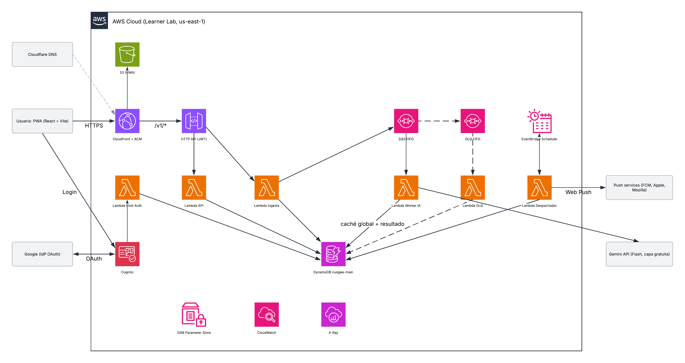
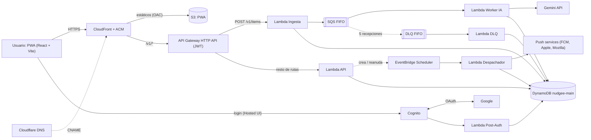
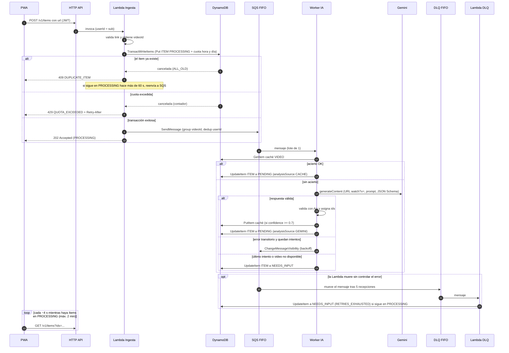
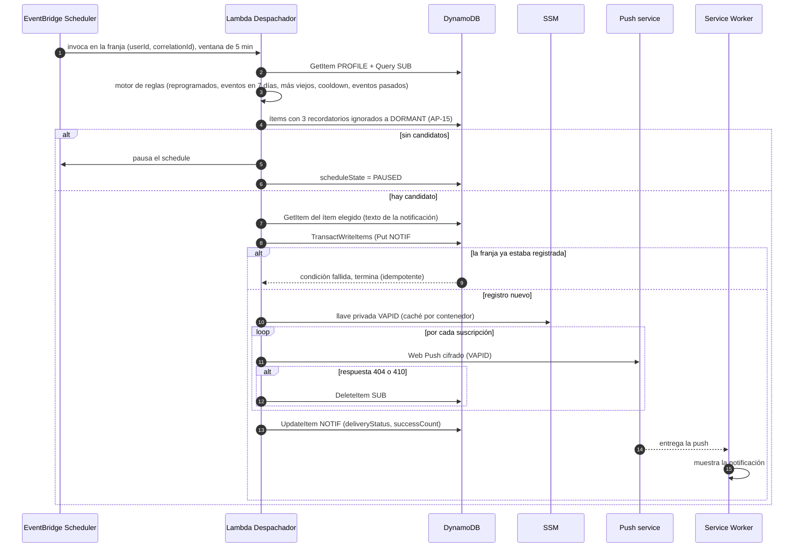
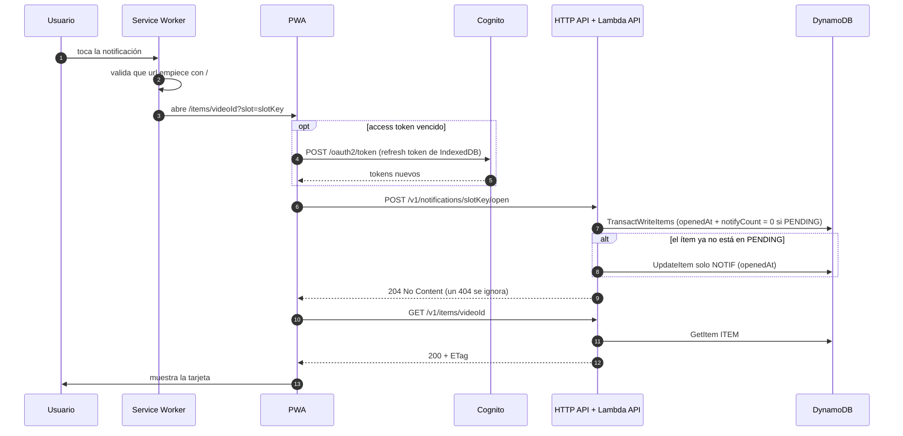

# Arquitectura (MVP)

| Campo | Valor |
| --- | --- |
| Producto | Nudgee |
| Documento | Arquitectura del MVP: componentes, servicios, flujos, decisiones y mapeo al AWS Well-Architected Framework |
| Versión | 1.0 |
| Fecha | 15 de octubre de 2026 |
| Responsable | Sara Aranda |
| Contexto | Proyecto final de *Sistemas Escalables* (ITESO) — Entregable #3 |
| Estado | Confirmado |
| Documentos relacionados | `Nudgee_Requerimientos_Funcionales_MVP.md` (v1.4), `Nudgee_Requerimientos_No_Funcionales_MVP.md` (v1.3 → v1.4), `Nudgee_Modelo_de_Datos.md` (v1.2 → v1.3), `Nudgee_Contratos_API.md` (v1.1 → v1.2) |
| Diagrama de componentes | [Lucidchart — Nudgee, diagrama de componentes (MVP)](https://lucid.app/lucidchart/fd16208e-dcc6-4e6d-8430-a54cbc02a817/edit) |

### Historial de cambios

| Versión | Cambios |
| --- | --- |
| 1.0 | Versión inicial confirmada: diagrama de componentes, catálogo de servicios, 8 deep dives, 3 diagramas de secuencia, decisiones ARQ-01…ARQ-20, mapeo a Well-Architected, entornos y verificaciones pendientes. Los cambios que provoca en NFR (v1.4), Modelo (v1.3) y Contratos (v1.2) se listan en §10 y ya están aplicados |

---

## 1. Vista general

Nudgee es una arquitectura **serverless y orientada a eventos** sobre AWS. El guardado responde de inmediato (`202`) y el análisis con IA ocurre de forma asíncrona detrás de una cola; los recordatorios los dispara un schedule por usuario.

**Flujo sencillo**

1. **Entrada.** La PWA se sirve desde CloudFront (dominio propio con DNS en Cloudflare). CloudFront también enruta `/v1/*` al HTTP API, que valida el JWT de Cognito.
2. **Login.** Cognito federa con Google; el trigger *Post Authentication* crea o actualiza el perfil en DynamoDB.
3. **Guardar.** La Lambda Ingesta valida el link, deduplica y descuenta la cuota en una sola transacción de DynamoDB, encola en SQS FIFO y responde `202`.
4. **Analizar.** El Worker IA consulta la caché global; si no hay acierto, llama a Gemini con la URL del video y JSON Schema, valida y escribe el resultado.
5. **Fallos.** Los fallos controlados terminan en `NEEDS_INPUT` desde el worker; la DLQ FIFO y su Lambda son la red de seguridad.
6. **Recordar.** EventBridge Scheduler invoca al Despachador en cada franja local del usuario; este elige el ítem y envía Web Push.

---

## 2. Diagrama de componentes

La versión oficial, con íconos de AWS, está en Lucid: [Nudgee — Diagrama de componentes (MVP)](https://lucid.app/lucidchart/fd16208e-dcc6-4e6d-8430-a54cbc02a817/edit). 

Vista textual equivalente:

Transversales (sin flechas en el diagrama): **SSM Parameter Store** (secretos), **CloudWatch** (logs, métricas, dashboard y alarmas) y **X-Ray** (trazas de las 6 Lambdas).

---

## 3. Catálogo de servicios

| Capa | Servicio | Rol | Por qué | Trazabilidad |
| --- | --- | --- | --- | --- |
| Edge | CloudFront + S3 (OAC) | Sirve la PWA y enruta `/v1/*` a la API (mismo origen) | Caché global, TLS, headers de seguridad, sin CORS | NFR-01, NFR-06, NFR-12 |
| Edge | ACM + Cloudflare DNS | Certificado y dominio estable | Origen fijo de la PWA entre despliegues | NFR-05, NFR-09 |
| Identidad | Cognito (Lite) + Google | Login federado, emisión de JWT | Sin contraseñas propias; 10k MAU gratis con IdP social | US-01…US-03, NFR-05, NFR-08 |
| API | API Gateway HTTP API | Authorizer JWT, enrutamiento, throttling | Más barato y rápido que REST API | NFR-01, NFR-05, NFR-07 |
| Cómputo | 6 Lambdas (TypeScript) | Post-Auth, API, Ingesta, Worker IA, DLQ, Despachador | Pay-per-use, escalado automático | NFR-02, NFR-14 |
| Mensajería | SQS FIFO + DLQ FIFO | Desacopla guardado y análisis; reintentos | Picos sin errores; serialización por video | NFR-02, NFR-03 |
| Datos | DynamoDB (tabla única) | Ítems, perfiles, suscripciones, notificaciones, cuota, caché de análisis | Escrituras condicionales, TTL, on-demand | D-01…D-10, NFR-03 |
| IA | Gemini API (Flash, capa gratuita) | Clasifica el video y extrae datos con JSON Schema | Lee la URL de YouTube directamente | C-04, C-05 |
| Recordatorios | EventBridge Scheduler | Un schedule por usuario en su zona horaria | Sin servidores; ventana flexible de 5 min | US-37, NFR-04 |
| Notificaciones | Web Push (VAPID) | Entrega del recordatorio al dispositivo | Estándar abierto, sin servicio de AWS extra | US-38, NFR-04 |
| Operación | CloudWatch, X-Ray, SSM | Observabilidad y secretos | Nativos, sin costo base relevante | NFR-08, NFR-10 |

---

## 4. Deep dives

### 4.1 Edge: CloudFront, S3, ACM y Cloudflare

- **Una distribución con dos *origins*.**
    - `/v1/*` va al HTTP API sin caché (`CachingDisabled`), con la *origin request policy* `AllViewerExceptHostHeader` (reenviar `Host` provoca `403`). Reenvía `Authorization`, `If-Match` y `X-Correlation-Id`, y deja pasar `ETag` y `Retry-After`.
    - El *default* va a S3 privado con OAC. Assets con hash: 1 año `immutable`; `index.html`, `sw.js` y el manifest: `no-cache`.
- **Rutas de la SPA con una CloudFront Function** en el *behavior* default. No se usan *custom error responses*, porque convertirían los `404` de la API en HTML.
- **Response headers policy:** CSP estricta sin `unsafe-inline` (`connect-src 'self'` + dominio de Cognito; `img-src 'self' https://i.ytimg.com`), HSTS, `X-Content-Type-Options` y `frame-ancestors 'none'`.
- **`PriceClass_100`** (cubre México).
- **S3:** privado, SSE-S3, `force_destroy = true`; el build se sube con `aws s3 sync` y `Cache-Control` por tipo.
- **ACM** en us-east-1, validado por DNS en Cloudflare; vive en el **stack persistente** (ARQ-05). El CNAME del dominio va en modo "DNS only".

### 4.2 HTTP API + Cognito

**HTTP API.** No ofrece X-Ray, WAF, usage plans ni validación de requests; se compensa así: X-Ray en las Lambdas, WAF en CloudFront (producción), cuota por usuario en DynamoDB y validación con Ajv.

| Ruta | Destino | Authorizer |
| --- | --- | --- |
| `GET /v1/health` | Lambda API | No |
| `POST /v1/items` | Lambda Ingesta | JWT |
| `ANY /v1/{proxy+}` | Lambda API (router interno) | JWT |
- Authorizer JWT con *issuer* del user pool y *audience* del app client; `userId = claims.sub` (NFR-05).
- Throttling inicial: stage 200 rps (ráfaga 400); `POST /v1/items` 60 rps. Se calibra con k6.
- *Access logs* JSON (sin PII, con `sub`), retención de 7 días. Métricas detalladas solo en `POST /v1/items` (ARQ-20).
- Riesgo aceptado: el endpoint `execute-api` es alcanzable sin CloudFront, pero exige JWT. En producción: header secreto de origen validado por el router.

**Cognito.**

| Aspecto | Decisión |
| --- | --- |
| Plan | Lite (10k MAU gratis con IdP social) |
| App client | Público, Authorization Code + PKCE, scopes `openid email profile`, solo Google |
| Tokens | Access e ID 60 min, refresh 30 días, revocación habilitada |
| Dominio | Prefijo fijo de Cognito (la *redirect URI* de Google no cambia) |
| IdP Google | Cliente OAuth creado una vez en Google Cloud Console; mapeo `email` y `name` |
- **Trigger Post Authentication (API-09):** síncrono, debe responder en ≤ 5 s y no corre al refrescar tokens. Upsert idempotente con defaults (`timezone = "UTC"`, `locale = "es-MX"`, `scheduleState = "NONE"`, `version = 1`). **Si falla, falla el login** (ARQ-10).
- **Tokens en la PWA:** access token en memoria; refresh token en IndexedDB. La mitigación de XSS es la CSP estricta y la prohibición de `dangerouslySetInnerHTML` (ARQ-11).

### 4.3 Lambda Ingesta (sin Redis ni VPC)

1. Valida el link (host, `/shorts/{id}`, ≤ 2,048 caracteres, body ≤ 32 KB) y reconstruye la URL canónica.
2. Ejecuta **una `TransactWriteItems`**: `Put` del ítem en `PROCESSING` (`attribute_not_exists`) + `Update` del contador por hora (`count < 30`) + `Update` del contador por día (`count < 100`).
    - Ítem existente: `409` con los datos del existente (`ALL_OLD`); la cuota no se toca (API-14).
    - Contador excedido: `429` con `Retry-After` al fin de la ventana.
    - Conflicto de transacción (solicitudes idénticas simultáneas): reintento con *backoff* corto.
3. `SendMessage` a SQS FIFO (`MessageGroupId = videoId`, `MessageDeduplicationId = userId#videoId`) y `202`. Si falla, borra el ítem y responde `503`.
4. **Reencolado (ARQ-15):** si llega un duplicado cuyo ítem sigue en `PROCESSING` desde hace más de 60 s, reenvía el mensaje. Cubre una caída entre la transacción y el `SendMessage`.

Lambda Node de 512 MB, empaquetada con esbuild, fuera de VPC. Se mantiene separada de la Lambda API para tener concurrencia, logs y métricas propias en la ruta crítica.

### 4.4 SQS FIFO + DLQ FIFO

| Aspecto | Decisión |
| --- | --- |
| Colas | `nudgee-analysis.fifo` y `nudgee-analysis-dlq.fifo`; sin deduplicación por contenido |
| Mensaje | `{userId, videoId, correlationId, savedAt}`, sin PII |
| Grupo | `MessageGroupId = videoId`: un video a la vez; videos distintos en paralelo |
| Consumo | *Event source mapping* con lote de 1 y **concurrencia máxima 2** (variable) |
| Tiempos | Timeout del worker 60 s; visibilidad 360 s (6×, recomendación de AWS) |
| Reintentos | `maxReceiveCount = 5`; *backoff* controlado con `ChangeMessageVisibility` (15, 30, 60, 120 s) |
| DLQ | La Lambda DLQ marca `NEEDS_INPUT`  • `RETRIES_EXHAUSTED` si el ítem sigue en `PROCESSING` |
- **Cabeza de fila:** un mensaje fallido bloquea solo a los siguientes del mismo video.
- **Tiempo a estado final (NFR-03):** ~5 min ante fallos controlados; si la Lambda muere sin controlar el error, la cota es `5 × 360 s` ≈ 30 min.
- **Alarma de DLQ** sobre la métrica EMF `AnalysisDeadLettered`, porque la Lambda DLQ vacía la cola casi al instante.

### 4.5 Worker IA + Gemini

1. Recibe un mensaje (lote de 1).
2. Lee la caché global `VIDEO#{videoId}` / `ANALYSIS#v{n}` (AP-21, consistente). `OK` vigente: copia al ítem (`analysisSource = CACHE`). `UNAVAILABLE`: `NEEDS_INPUT` + `VIDEO_UNAVAILABLE`.
3. Sin acierto, llama a Gemini con `https://www.youtube.com/watch?v={videoId}`, el prompt (reglas RF §3.3) y salida JSON con el JSON Schema. Modelo en `GEMINI_MODEL`; timeout en código ~45 s.
4. Valida con Ajv contra el mismo schema (NFR-06) y asigna `id` (`i{n}`, `e{n}`). El contenido del video es entrada no confiable: solo se aceptan campos del schema y nunca URLs de la IA.
5. Si `confidence ≥ 0.7`, guarda en la caché (AP-22). Siempre actualiza el ítem a `PENDING` con condición `status = PROCESSING` (`aiOriginal`, `readyAt`, `analysisSource = GEMINI` y, en `EVENT`, `eventDate`).
6. Errores: `429`, `5xx` y timeout con *backoff*; en el último intento, `NEEDS_INPUT` (`AI_ERROR` o `RETRIES_EXHAUSTED`). `INVALID_OUTPUT` no se cachea. Video no disponible: `NEEDS_INPUT` inmediato y caché negativa de 1 h.

**Límites de la capa gratuita de Gemini:** solo videos públicos (no privados ni no listados) y hasta 8 horas de video de YouTube por día; con Shorts de hasta 3 min son al menos 160 análisis diarios. Los límites por minuto y por día se consultan en AI Studio. La API key se lee de SSM una vez por contenedor.

### 4.6 DynamoDB

- Tabla única `nudgee-main`: on-demand, TTL en `expiresAt`, SSE, sin Streams, sin PITR en el MVP (Modelo §4.1).
- Escrituras condicionales por transición (T-xx) y *optimistic locking* con `version`.
- Transacciones: guardado (ítem + dos contadores), registro de recordatorio (AP-13) y apertura desde la push (AP-14).
- GSI1 disperso con los ítems `PENDING`, eventualmente consistente; la escritura final del despachador es condicional.
- Caché global en la partición `VIDEO#`; un video viral queda muy por debajo del límite por partición (D-09).
- `QUOTA_COUNTER` es la fuente principal de la cuota (D-06, ARQ-07).

### 4.7 EventBridge Scheduler + Despachador

- **Un schedule por usuario** `nudgee-{userId}` en el grupo `nudgee-reminders` (Terraform): `cron(0 9,14,19 * * ? *)` con la zona del perfil y ventana flexible de 5 min. Lo crea la Lambda API al registrar la primera suscripción (E-20).
- **Pausa perezosa (ARQ-16):** el Despachador pausa el schedule cuando no hay candidatos; las transiciones hacia `PENDING` lo reanudan (AP-17).
- **Despachador:** lee perfil, suscripciones y GSI1 → motor de reglas puro con reloj inyectable (NFR-11) → transacción idempotente por `slotKey` (AP-13) → Web Push con `web-push` y VAPID desde SSM → `404`/`410` borra la suscripción → actualiza `deliveryStatus`. Los ítems con 3 recordatorios ignorados pasan a `DORMANT` (AP-15).
- **Reintentos del Scheduler:** 2 intentos, edad máxima de 10 min; la idempotencia la da `NOTIF#{slotKey}`.
- **Escala:** 10k envíos en 5 min ≈ 13 invocaciones concurrentes si cada una tarda ~0.4 s (estimación). Depende del límite de concurrencia de la cuenta (V-01).
- **Limitación aceptada:** si el push service falla por completo, la franja ya quedó registrada y cuenta como ignorada.

### 4.8 Observabilidad y secretos

- **Logs** JSON con `correlationId` (API → SQS → worker → Scheduler → push), sin PII, retención de 7 días.
- **Métricas EMF** (sin llamadas extra en la ruta crítica):

| Métrica | Emisor | Dimensión |
| --- | --- | --- |
| `AnalysisDurationMs` (`readyAt − savedAt`) | Worker | `analysisSource` |
| `GeminiCallMs` | Worker | — |
| `GeminiError` | Worker | tipo (`429`, `5xx`, `INVALID_OUTPUT`) |
| `SaveAccepted`, `SaveDuplicate`, `QuotaExceeded` | Ingesta | — |
| `AnalysisDeadLettered` | Lambda DLQ | — |
- **X-Ray** en las 6 Lambdas.
- **Dashboard de CloudWatch** (Terraform): p95/p99 del guardado, profundidad y edad de la cola, DLQ, errores de Gemini, tasa de aciertos de la caché y éxito de push.
- **Alarmas:** `AnalysisDeadLettered > 0`; 5xx > 1% durante 5 min; mensaje más viejo > 5 min. Alertas de presupuesto al 50% y 80% de $50.
- **Secretos:** `GEMINI_API_KEY`, `VAPID_PRIVATE_KEY` y el *client secret* de Google como SSM SecureString, creados **una vez** en el stack persistente con `aws ssm put-parameter`. Las Lambdas los leen en tiempo de ejecución por nombre; no pasan por el state, salvo el *client secret* de Google, que Terraform necesita para el IdP de Cognito.

---

## 5. Flujos (diagramas de secuencia)

### 5.1 Guardar y analizar (incluye caché, fallo y DLQ)

### 5.2 Disparo de recordatorio y envío push

### 5.3 Abrir la tarjeta desde la push

---

## 6. Decisiones de arquitectura (ARQ)

Todas confirmadas el 15 de octubre de 2026.

| ID | Decisión | Alternativa descartada | Trade-off | Trazabilidad |
| --- | --- | --- | --- | --- |
| ARQ-01 | TypeScript en las Lambdas y React + Vite en la PWA | Python en el backend | Un solo lenguaje y el mismo JSON Schema con Ajv en servidor, formulario y validación de la IA | NFR-06 |
| ARQ-02 | API Gateway **HTTP API** | REST API | Más barata y rápida; sin X-Ray, WAF, usage plans ni validación (se compensan) | NFR-01, NFR-10, NFR-14 |
| ARQ-03 | **Mismo origen:** CloudFront enruta `/v1/*` | API en subdominio | Sin CORS y con `ETag` visible; un *behavior* más en CloudFront | API-02, NFR-06 |
| ARQ-04 | Rutas de la SPA con **CloudFront Function** | *Custom error responses* | Los `404` de la API se conservan en RFC 9457 | API-03 |
| ARQ-05 | **Stack persistente:** certificado ACM, *bucket* del state y secretos SSM | Recrearlos en cada sesión | `apply` más rápido; excepción explícita a C-02/NFR-09 (sin costo ni datos de usuario) | NFR-09 |
| ARQ-06 | Secretos en **SSM Parameter Store** | Secrets Manager | Gratis; Secrets Manager cobra y su ventana de recuperación rompe el ciclo `destroy`/`apply` | NFR-08 |
| ARQ-07 | **Sin ElastiCache ni VPC:** dedupe y cuota en una `TransactWriteItems` | Redis + VPC + *endpoint* de SQS | Menos piezas, `apply` más rápido y sin costo por hora; unos ms más de latencia | NFR-03, NFR-07, NFR-14 |
| ARQ-08 | **6 Lambdas** (Post-Auth, API con router, Ingesta, Worker, DLQ, Despachador) | Una por endpoint o una sola | Aislamiento de la ruta crítica sin multiplicar Terraform | NFR-02 |
| ARQ-09 | **Cognito Lite** con dominio de prefijo fijo | Essentials; dominio propio | Más barato a escala; URL de login menos pulida | NFR-05, NFR-09 |
| ARQ-10 | **Post-Auth falla el login** si no escribe el perfil | Ignorar el error | Garantiza perfil, zona horaria y schedule; si DynamoDB cae nadie entra | API-09 |
| ARQ-11 | Access token en memoria, refresh token en IndexedDB | BFF con cookie `httpOnly` | Sesión de 30 días sin otra Lambda; XSS mitigado con CSP | US-02, NFR-06 |
| ARQ-12 | SQS: timeout 60 s, visibilidad 360 s, `maxReceiveCount = 5`, lote 1 | 3 intentos y timeout 45 s | Sigue las recomendaciones de AWS; NFR-03 se precisa | NFR-03 |
| ARQ-13 | **Concurrencia máxima del *event source mapping**  • para la cuota de Gemini | *Reserved concurrency* | No depende de lo que permita la cuenta del Lab | NFR-02, C-04 |
| ARQ-14 | `NEEDS_INPUT` lo escribe el worker; la Lambda DLQ es red de seguridad | Solo DLQ | Respuesta rápida en fallos controlados; cubre caídas del worker | T-03 |
| ARQ-15 | **Reencolar** duplicados en `PROCESSING` de más de 60 s | Barrido periódico | Sin infraestructura nueva; solo cubre el caso en que el usuario reintenta | NFR-03 |
| ARQ-16 | Schedule por usuario con **pausa perezosa** | Pausar en cada acción del usuario | Menos llamadas en la ruta del usuario; una invocación vacía de más | RF §5 |
| ARQ-17 | Gemini API **capa gratuita**, URL `watch?v=` | Nivel de pago | $0; ~160+ análisis/día; la escala de diseño se demostrará con un stub (diferido) | C-03, C-04 |
| ARQ-18 | Observabilidad con **CloudWatch + EMF + X-Ray** | Grafana (Managed Grafana no es viable en el Lab) | Todo en Terraform y efímero | NFR-10 |
| ARQ-19 | **Entornos:** unit tests, local con Docker, Learner Lab | Desarrollar en el Lab; LocalStack | Desarrollo rápido y sin créditos; el Lab solo para integrar | NFR-11 |
| ARQ-20 | **Métricas detalladas** solo en `POST /v1/items` | Métrica global del API | Separa el p95 del guardado del de las lecturas con costo mínimo | NFR-01 |

---

## 7. Mapeo al AWS Well-Architected Framework

| Pilar | Cómo se cumple | Brechas del MVP |
| --- | --- | --- |
| Excelencia operativa | IaC con Terraform (`apply`/`destroy`), CI en cada PR, logs JSON con `correlationId`, EMF, dashboard y alarmas, *seed script* | Sin runbooks formales |
| Seguridad | Cognito + Google, JWT en el API, `userId` del token, CSP y headers, validación con JSON Schema, links por plantilla, lista blanca de push services, SSM SecureString, cifrado en reposo, sin PII en logs | `LabRole` sin mínimo privilegio; sin WAF |
| Fiabilidad | SQS FIFO + DLQ, escrituras condicionales y transacciones, idempotencia (`slotKey`, dedupe), *backoff*, compensación ante `503`, reencolado | Una región, sin PITR ni garantía de disponibilidad |
| Eficiencia de rendimiento | Serverless, `202` asíncrono, caché global de análisis, GSI disperso, concurrencia controlada del worker, caché de CloudFront | Capacidad de análisis limitada por la capa gratuita de Gemini |
| Optimización de costos | Pay-per-use, sin NAT, VPC ni Redis, HTTP API, Cognito Lite, `PriceClass_100`, infraestructura efímera, alertas de presupuesto | — |
| Sostenibilidad | Sin capacidad ociosa, entorno destruido al cerrar la sesión, la caché evita repetir llamadas a la IA | — |

---

## 8. Entornos

| Nivel | Dónde | Qué se prueba | Frecuencia |
| --- | --- | --- | --- |
| 1. Unit tests | Local y CI, sin AWS | Motor de recordatorios (reloj inyectable), máquina de estados, JSON Schema, parseo de URLs | Constante |
| 2. Local | Docker Compose | App completa: Vite con *proxy* a `/v1`, handlers con un adaptador HTTP, DynamoDB Local, ElasticMQ (SQS FIFO), `sub` de prueba, *fixtures* de Gemini, VAPID de desarrollo | Diario |
| 3. Learner Lab | AWS real | Cognito + Google, CloudFront y CSP, X-Ray, Scheduler, push en el celular, demo | Por sesión |

---

## 9. Riesgos y verificaciones pendientes (C-08)

| ID | Qué verificar | Cómo | Plan B |
| --- | --- | --- | --- |
| V-01 | Límite de concurrencia de Lambda de la cuenta | `aws lambda get-account-settings` | Reducir la concurrencia del worker y aceptar más tiempo de envío por franja |
| V-02 | Scheduler con `LabRole` como rol de ejecución | `aws scheduler create-schedule … --target RoleArn=LabRole` | Regla cada 5 min + Despachador que consulte usuarios por franja (requiere un GSI por zona y franja) |
| V-03 | Cognito: dominio de prefijo e IdP Google | `create-user-pool-domain`, `create-identity-provider` | Ninguno razonable (crítico) |
| V-04 | Post-Auth se dispara con el login de Google | Log de `triggerSource` en la primera sesión | Otro trigger de primer login |
| V-05 | SQS FIFO disponible | `aws sqs create-queue … FifoQueue=true` | Ninguno razonable (crítico) |
| V-06 | `apply` ≤ 15 min con CloudFront | Medir en la primera sesión | Crear CloudFront al inicio de la sesión en un paso aparte |
| V-07 | Pantalla de consentimiento de Google | Publicar la app o agregar *test users* (tope de 100) | Agregar a los usuarios del salón como *test users* |
| V-08 | Límites de Gemini y formato de URL | AI Studio; prueba con un Short usando `watch?v=` | Ajustar la concurrencia o pasar al nivel de pago |

---

## 10. Cambios a otros documentos (aplicados el 15 de octubre de 2026)

| Documento | Cambios |
| --- | --- |
| **NFR v1.3 → v1.4** | C-02, NFR-09 y §6: stack persistente (ACM, *bucket* del state, secretos SSM) como excepción. C-06 y C-08: quitar ElastiCache; agregar la verificación de Scheduler con `LabRole`. NFR-01: métricas detalladas en `POST /v1/items`. NFR-03: quitar el criterio y la prueba con Redis; precisar 15 min ante fallos controlados y la cota ante caídas del worker. NFR-06: CSP por *response headers policy* de CloudFront. NFR-07: cuota en DynamoDB. NFR-10: X-Ray en las Lambdas (no en el API), métricas EMF y alarma sobre `AnalysisDeadLettered`. NFR-14: sin excepción de ElastiCache. §6: quitar Redis y la VPC; concurrencia máxima del *event source mapping* en lugar de *reserved concurrency*; *bucket* del state persistente |
| **Modelo v1.2 → v1.3** | D-06: `QUOTA_COUNTER` como fuente principal. Quitar §6 (Redis). AP-02 y AP-16 se funden en la transacción de guardado. Defaults de AP-01 (`timezone = "UTC"`, `locale = "es-MX"`, `scheduleState = "NONE"`, `version = 1`) |
| **Contratos v1.1 → v1.2** | §2.1–2.2: base URL en el mismo dominio y sin nota de CORS. §2.5: agregar `404 ROUTE_NOT_FOUND`. E-05: flujo con `TransactWriteItems`, sin Redis ni su *fallback*; reencolado de duplicados en `PROCESSING` de más de 60 s |
| **RF v1.4** | Sin cambios |

---

## 11. Limitaciones conocidas (adicionales a NFR §7)

| Limitación | Causa |
| --- | --- |
| La escala de diseño (50k análisis/día) no se puede demostrar contra Gemini real | Capa gratuita de Gemini (ARQ-17); se resolverá con un stub en el entregable #8 |
| Un fallo total del push service cuenta la franja como ignorada | El registro se hace antes del envío para garantizar máximo uno por franja |
| El endpoint `execute-api` es alcanzable sin pasar por CloudFront | HTTP API sin WAF ni políticas de recurso; el JWT sigue siendo obligatorio |
| Un ítem puede quedar en `PROCESSING` si la Lambda Ingesta cae entre la transacción y el envío y el usuario no reintenta | ARQ-15 solo cubre el reintento |
| Si el Lab se resetea, hay que recrear el stack persistente y los secretos SSM | C-01 |