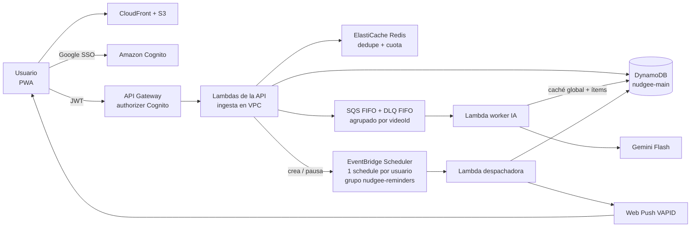

# Descripción del proyecto

<aside>
🔔

Plataforma web/PWA diseñada para resolver el **"síndrome del acumulador digital"**, transformando posts guardados de videos cortos en **acciones concretas y ejecutables**. Utiliza inteligencia artificial multimodal (Gemini API) para analizar e indexar ingredientes, materiales o títulos a partir del audio y texto visual del video, y una arquitectura distribuida y serverless en AWS (API Gateway, SQS, DynamoDB, EventBridge Scheduler y Web Push) que programa recordatorios inteligentes para cerrar la brecha entre guardar contenido y realizarlo.

</aside>

---

# 1. Producto

| Nombre | **Nudgee** |
| --- | --- |
| Contexto | Entrega final de **Sistemas Escalables (ITESO)**  |
| Problema | "Síndrome del acumulador digital": la gente guarda videos cortos (recetas, rutinas, tutoriales, películas, lugares, libros, música, podcasts y eventos) y nunca los ejecuta |
| Propuesta de valor | PWA que convierte videos guardados en **acciones concretas** usando IA multimodal y recordatorios push en el momento adecuado, cerrando la brecha entre "guardar" y "hacer" |
| Principios de diseño | Fricción mínima al guardar (pegar link → confirmación en ≤ 2 interacciones) · Reactivar sin ser invasivo (máx. 3 recordatorios al día, *cooldown*, ítems ignorados pasan a "Dormido") |

---

# 2. Alcance del MVP (confirmado)

| Tema | Decisión |
| --- | --- |
| Plataforma | PWA responsiva móvil-first (360–1440 px), instalable; instalación recomendada, no obligatoria. UI en español (es-MX), i18n-ready |
| Autenticación | Google SSO con **Amazon Cognito** (access token 60 min, refresh 30 días) |
| Fuente | Solo **YouTube Shorts** |
| Ingesta | Única vía: **pegar la URL** manualmente. Se extrae el `videoId` y se guarda solo la URL canónica |
| IA | **Gemini Flash** lee la URL directamente (sin descargar el video), salida con **JSON Schema** y **caché global por video** (un análisis se reutiliza entre usuarios). Si falla → estado `NEEDS_INPUT` y formulario generado desde el mismo schema |
| Categorías | 10: Receta, Rutina, Tutorial, Película/serie, Lugar/restaurante, Libro, Música, Podcast, Evento, Otro, cada una con campos, acción específica (checklist, JustWatch, Maps, Google Books, Spotify, calendario, boletos) y botón "Hecho" propio. Un video con varias recomendaciones se guarda como un ítem con lista (máx. 20 entradas) |
| Estados | `PROCESSING`, `NEEDS_INPUT`, `PENDING`, `DORMANT`, `DONE`, `DISCARDED` (borrado suave; TTL a 30 días) |
| Recordatorios | 3 franjas fijas (09:00, 14:00, 19:00 hora local), máx. 1 por franja, máx. 3 por ítem, cooldown de 3 días; prioridad: reprogramados → eventos en los próximos 7 días → más viejos; eventos pasados no elegibles. Valores configurables para la demo |
| Biblioteca | Filtros por categoría y estado + búsqueda en el cliente; polling cada 3–5 s mientras haya ítems en análisis |
| Fuera de alcance | GPS/ubicación, Share Sheet (Web Share Target), TikTok/Instagram, importación masiva de JSON, rachas/logros, botones en notificaciones, exportar datos/eliminar cuenta, producto/wishlist, plataformas de streaming (TMDB) → **backlog post-MVP** |

---

# 3. Arquitectura y restricciones

## 3.1 Restricciones clave

- **AWS Academy Learner Lab:** rol fijo `LabRole`, sesiones de ~4 h, créditos limitados; servicios por verificar (Cognito + Google IdP, ElastiCache, ACM, EventBridge Scheduler con *schedule groups*, SQS FIFO).
- **Infraestructura efímera con Terraform:** se construye y destruye en cada sesión (`apply` ≤ 15 min sin pasos manuales; `destroy` sin residuos). Datos de prueba vía seed script.
- **Presupuesto:** ≤ ~$50 USD/mes (AWS + Gemini). Servicios pay-per-use; sin NAT Gateway.
- **Escala de diseño (demostrada con k6):** 10k DAU, ~50k análisis/día, picos de 30 guardados/s por 5 min, ≤ 10k push por franja. La cuota de Gemini es el cuello de botella.

## 3.2 Stack

| Capa | Decisión |
| --- | --- |
| Edge | CloudFront + S3 (PWA), dominio propio con DNS en Cloudflare y certificado ACM |
| API | API Gateway con authorizer JWT de Cognito (`userId` siempre del `sub`), throttling por stage y cuota por usuario (30/h, 100/día → `429` con `Retry-After`) |
| Ingesta | Lambda (única en VPC) → `202 Accepted` (p95 ≤ 300 ms); deduplicación con Redis (ElastiCache) `SET NX` con TTL sobre `userId#videoId`, con la escritura condicional en DynamoDB como fuente de verdad y fallback si Redis no está disponible. Redis es una optimización: la garantía de no duplicar la dan la escritura condicional y SQS FIFO |
| Asincronía | **SQS FIFO** (`MessageGroupId = videoId`) + DLQ FIFO; *backoff* con `ChangeMessageVisibility`; reintentos agotados → `NEEDS_INPUT` |
| Worker de IA | Lambda fuera de la VPC con *reserved concurrency* ajustada a la cuota de Gemini (429 < 1%; análisis p95 ≤ 30 s). Consulta la caché global antes de llamar a Gemini (con acierto, p95 ≤ 5 s) |
| Persistencia | DynamoDB **Single-Table Design**, escrituras condicionales por transición de estado, *optimistic locking* (`version`) y TTL (`expiresAt`); caché global de análisis en la misma tabla (`VIDEO#{videoId}`) |
| Recordatorios | **Un schedule recurrente por usuario** en EventBridge Scheduler (flexible time window de 5 min), dentro del schedule group `nudgee-reminders` gestionado por Terraform → Lambda despachadora que elige el ítem y envía Web Push (VAPID); `404/410` elimina la suscripción. El schedule se pausa sin pendientes o sin suscripciones |
| Seguridad | Validación server-side contra el JSON Schema compartido, links solo desde plantillas fijas, CSP estricta, sin `dangerouslySetInnerHTML`; cifrado en reposo, secretos en SSM; sin PII en logs |
| Observabilidad | Logs JSON con `correlationId` (API → SQS → worker → Scheduler → push), X-Ray, dashboard y alarmas de CloudWatch definidos en Terraform |
| Calidad | Motor de recordatorios como funciones puras con reloj inyectable (≥ 80% cobertura), CI en cada PR (lint, tests, `terraform fmt/validate`) |
| Producción (documentada, no implementada) | 99.9% de disponibilidad, PITR, un rol IAM por función, AWS WAF |

## 3.3 Vista general

<aside>
ℹ️

Vista simplificada derivada del stack confirmado. El diagrama de componentes formal, los diagramas de secuencia y los ADRs son parte del **entregable #3 (documento de arquitectura)**.

</aside>

