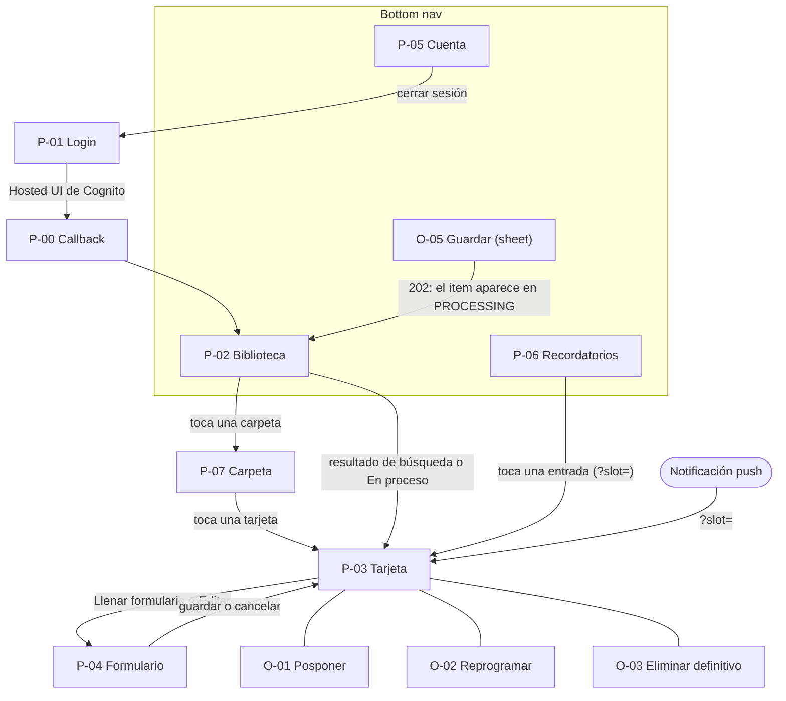

# Diseño UX de la PWA (MVP)

| Campo | Valor |
| --- | --- |
| Producto | Nudgee |
| Documento | Diseño de experiencia de la PWA: arquitectura de información, estados por pantalla, sistema de diseño y mockups |
| Versión | 0.3 |
| Fecha | 3 de noviembre de 2026 |
| Responsable | Sara Aranda |
| Contexto | Proyecto final de *Sistemas Escalables* (ITESO) — Entregable #6 |
| Estado | Confirmado (§1–§4) |
| Documentos relacionados | `Nudgee_Requerimientos_Funcionales_MVP.md` (v1.6), `Nudgee_Requerimientos_No_Funcionales_MVP.md` (v1.6), `Nudgee_Modelo_de_Datos.md` (v1.5), `Nudgee_Contratos_API.md` (v1.4), `Nudgee_Arquitectura.md` (v1.2) |

## Historial de cambios

| Versión | Cambios |
| --- | --- |
| 0.1 | §1 Arquitectura de información confirmada: decisiones UX-01…UX-07 y NTF-01…NTF-07, navegación, inventario de pantallas y overlays, mapa de navegación y cobertura de user stories. Los cambios que provocó en RF v1.6, NFR v1.6, Modelo v1.5, Contratos v1.4 y Arquitectura v1.2 se listan en §5 y ya están aplicados |
| 0.2 | Alcance reducido a lo esencial para implementar: §2 estados y errores por pantalla, §3 sistema de diseño (artifact) y §4 mockups; la especificación de implementación se prepara en `.claude/`. Biblioteca por carpetas de categoría (UX-08…UX-11; ajustes a UX-01, UX-04 y UX-05): P-02 redefinida y nueva P-07. Sistema de diseño confirmado (§3) |
| 0.3 | §2 Estados y errores por pantalla confirmada (incluye el toast "Listo" al terminar el análisis); §4 Mockups entregados en el canvas de Claude (18 pantallas y overlays); enlaces al sistema de diseño y al canvas |

---

---

# 1. Arquitectura de información

## 1.1 Principios que guían el diseño

| Principio | Cómo se aplica | Trazabilidad |
| --- | --- | --- |
| Fricción mínima al guardar | Guardar está siempre a un toque (botón circular junto al nav); pegar y tocar "Guardar" son 2 interacciones | US-04, US-05, NFR-13 |
| Reactivar sin invadir | Máx. 3 recordatorios al día; la bandeja funciona aunque el push esté apagado; los ignorados pasan a "Dormido" | US-37, US-42, US-51 |
| Enfocar en actuar | La biblioteca muestra carpetas con lo que queda por hacer; dentro, la vista por defecto es "Por hacer" | US-11, US-13 |
| Accesible desde el inicio | WCAG 2.2 AA, objetivos táctiles ≥ 44 px, filtros usables a 360 px, textos externalizados para i18n | NFR-13 |

## 1.2 Decisiones de experiencia (UX)

| ID | Decisión | Alternativa descartada | Trade-off | Trazabilidad |
| --- | --- | --- | --- | --- |
| UX-01 | **Bottom nav** con cuatro destinos: barra flotante con Biblioteca, Recordatorios y Cuenta, y Guardar como botón circular junto a ella (§1.4) | Navegación de un solo nivel sin *tab bar* | Destinos visibles y alcanzables con el pulgar; ocupa 64 px de alto a 360 px | US-04, US-11, US-51 |
| UX-02 | **La tarjeta es una ruta propia** (`/items/:videoId`), en una sola columna centrada en todos los anchos. En desktop la biblioteca se muestra como cuadrícula | *Bottom sheet* sin ruta; dos paneles en desktop | El *deep link* del recordatorio y el botón "atrás" funcionan de forma nativa; dos paneles costaban más para el plazo del MVP | US-16, US-38, API-07 |
| UX-03 | **Pegar y luego tocar "Guardar"**. Un link inválido muestra el error en línea al tocar "Guardar"; el botón nunca se deshabilita | Guardar automáticamente al pegar | El usuario revisa antes de enviar y se cumplen las 2 interacciones medidas desde el pegado (NFR-13). Los botones deshabilitados son poco accesibles | US-04, US-06, NFR-13 |
| UX-04 | **La categoría va en la ruta y el resto en el *query string***: `/library/:category?status=` en la carpeta y `/?q=` en la búsqueda del inicio | Estado solo en memoria | Al volver de la tarjeta o recargar se conserva el contexto; hay que sincronizar la URL con el estado | US-12–US-14 |
| UX-05 | **Vista por defecto "Por hacer" dentro de cada carpeta** (`PENDING`), con chips "Todos" y por estado; el contador de la carpeta cuenta lo mismo | Mostrar todo por defecto | Enfoca la biblioteca en actuar. `PROCESSING` y `NEEDS_INPUT` viven en la franja En proceso (UX-09) | US-11, US-13 |
| UX-06 | **Ruta de edición compartida** (`/items/:videoId/edit`) para el formulario de `NEEDS_INPUT` y la edición. En `PROCESSING`, `DONE` o `DISCARDED` redirige a la tarjeta | Edición en línea dentro de la tarjeta | Un solo renderer desde el JSON Schema, una validación y un "descartar cambios" claro; una edición pequeña cuesta una navegación (el checklist no es edición, E-18) | US-10, US-31–US-34, RF §4.4 |
| UX-07 | **Sin instrucciones de instalación en iOS** (US-36 al backlog). Si el navegador no soporta Web Push, en lugar del banner de US-35 aparece un texto fijo: *"Para recibir recordatorios, agrega Nudgee a tu pantalla de inicio"* | Ocultar el banner sin explicación | Una sola cadena de i18n, sin pantalla ni pasos; evita que el usuario de iOS no sepa por qué no recibe push. La instalación se explica en persona | US-35, C-07 |
| UX-08 | **Biblioteca por carpetas de categoría:** el inicio muestra una carpeta "Todo" y una por categoría; las tarjetas viven dentro de cada carpeta (P-07) | Todas las tarjetas en el inicio | Visión rápida de "qué tengo" con poco ruido; ver un ítem cuesta un toque más. "Todo" mantiene US-11 | US-11, US-12 |
| UX-09 | **Franja "En proceso"** arriba de las carpetas para `PROCESSING` y `NEEDS_INPUT`; solo aparece si hay ítems | Mostrarlos dentro de una carpeta | Un video recién guardado aún no tiene categoría; la franja da retroalimentación del análisis y del formulario pendiente | US-09, US-10 |
| UX-10 | **Solo carpetas con ítems, en el orden fijo de RF §3.1** | Ordenar por actividad reciente | Memoria espacial: cada carpeta siempre está en el mismo lugar; ordenar por actividad las reacomodaría en cada visita | US-12 |
| UX-11 | **La búsqueda del inicio abarca todo:** al escribir, las carpetas se reemplazan por resultados en tarjetas | Buscar solo dentro de cada carpeta | US-14 sin entrar a cada carpeta | US-14 |

## 1.3 Decisiones de la bandeja de recordatorios (NTF)

Estas decisiones cambiaron reglas confirmadas del motor de recordatorios; los documentos afectados ya están actualizados (§5).

| ID | Decisión | Trade-off | Trazabilidad |
| --- | --- | --- | --- |
| NTF-01 | **Bandeja unificada:** cada recordatorio se registra en `NOTIF#{slotKey}` y aparece en la bandeja; el push es un canal adicional si hay suscripciones (`deliveryStatus = IN_APP` cuando no las hay) | Un solo historial en todos los dispositivos | US-51, D-11 |
| NTF-02 | **Schedule siempre encendido:** se crea una sola vez desde E-04, cuando la PWA envía la zona horaria real, y no se pausa | Elimina la lógica de pausa y reanudación y deja al Worker IA sin dependencia de Scheduler; cuesta invocaciones vacías de costo despreciable | RF §5, ARQ-21, AP-17 |
| NTF-03 | **Abrir la tarjeta desde la bandeja cuenta como respuesta**, igual que desde el push (E-19) | Mismo significado sin importar el canal | D-04, T-07 |
| NTF-04 | **"Ignorado" no depende del canal:** un recordatorio no abierto cuenta para pasar a `DORMANT` | El motor no cambia; quien no abre la app en ~9 días encuentra ítems dormidos, visibles en la bandeja y reactivables (US-25) | US-42, T-07 |
| NTF-05 | **"No leído" = sin `openedAt`**; contador en el tab Recordatorios; sin "marcar todo como leído" en el MVP | Sin atributos nuevos; marcar sin abrir no debe reiniciar `notifyCount` | US-52, D-11 |
| NTF-06 | **Instantánea en el registro** (`category`, `title`, `messageKey`, `messageParams`); si el ítem ya no existe, la entrada lo indica y no abre nada | Sobrevive al borrado del ítem y respeta i18n | US-51, D-11, API-18 |
| NTF-07 | **E-22 paginado por cursor** (20 por defecto, hasta 100); `unreadCount` solo en la primera página, calculado con un `Query` `COUNT` | La bandeja escala con el TTL y el contador es exacto; cuesta una lectura extra en la primera página | US-51, US-52, API-17, AP-23 |

## 1.4 Navegación

| Destino del bottom nav | Acción al tocar | Indicador |
| --- | --- | --- |
| Biblioteca | Va a `/` | — |
| Guardar (botón circular) | Abre el *bottom sheet* O-05 con el campo enfocado (no cambia la ruta) | — |
| Recordatorios | Va a `/reminders` | Contador de no leídos (US-52) |
| Cuenta | Va a `/account` | — |
- El bottom nav se muestra en P-02, P-05, P-06 y P-07. Se oculta en P-00, P-01, P-03, P-04 y P-404, para dejar espacio a las acciones.
- En desktop (≥ 1024 px) se mantiene la misma barra flotante, centrada sobre la columna de `content-max` (sistema de diseño); no tiene mockup propio (§4).

## 1.5 Inventario de pantallas

| ID | Pantalla | Ruta | Estados del ítem | Endpoints | US |
| --- | --- | --- | --- | --- | --- |
| P-00 | Callback de autenticación (solo *spinner*) | `/auth/callback` | — | Intercambio de código PKCE (Contratos §8) | US-01 |
| P-01 | Login | `/login` | — | Hosted UI de Cognito | US-01, US-02 |
| P-02 | Biblioteca (inicio): buscador, franja En proceso (UX-09), carpetas de categoría (UX-08) o resultados de búsqueda (UX-11), banner de push o texto fijo (UX-07) | `/` (`?q=` al buscar) | Todos | E-02, E-03, E-04 (silencioso al iniciar), E-06 (listado y polling), E-20 | US-09, US-11, US-12, US-14, US-35 |
| P-03 | Tarjeta del ítem (variantes por estado, RF §4.4, y por categoría) | `/items/:videoId` (con `?slot=` si viene de un recordatorio) | Todos | E-07, E-10–E-18, E-19 si trae `?slot=` | US-15–US-30, US-38, US-43–US-50 |
| P-04 | Formulario de `NEEDS_INPUT` y edición (mismo renderer) | `/items/:videoId/edit` | `NEEDS_INPUT`, `PENDING`, `DORMANT` (UX-06) | E-09, E-08 | US-10, US-31–US-34 |
| P-05 | Cuenta: nombre y correo, recordatorios push en este dispositivo, cerrar sesión | `/account` | — | E-03, E-20, E-21 + logout de Cognito | US-03, US-35 |
| P-06 | Recordatorios (bandeja) | `/reminders` | — | E-22, E-19 (al abrir una entrada) | US-51, US-52 |
| P-07 | Carpeta de categoría: título, chips de estado (por defecto "Por hacer") y cuadrícula de tarjetas | `/library/:category` (`all` para Todo; `?status=`) | Todos | E-06 (datos ya cargados en el cliente) | US-11–US-13 |
| P-404 | No encontrado | `*` | — | — | — |

Las rutas de la SPA las resuelve la CloudFront Function del *behavior* default (Arquitectura ARQ-04).

## 1.6 Overlays y elementos en línea

| ID | Elemento | Vive en | Endpoint | US |
| --- | --- | --- | --- | --- |
| O-01 | Posponer (opciones de `snoozeOptions`, E-02) | P-03 | E-12 | US-19 |
| O-02 | Reprogramar (selector de día) | P-03 | E-13 | US-20 |
| O-03 | Confirmar eliminación definitiva | P-03 | E-17 | US-24 |
| O-05 | Guardar: campo para pegar el link y botón "Guardar" (UX-03) | Bottom nav | E-05 | US-04–US-07 |
| En línea | Banner de US-35 o texto fijo de UX-07 | P-02, P-05 | E-20 | US-35 |
| En línea | Sugerencias: descartar tras 3 pospuestos, marcar la lista como hecha, evento pasado | P-03 | — | US-21, US-46, US-49 |
| En línea | *"Se eliminará en X días"* | P-03 (`DISCARDED`) | — | US-43 |
| En línea | *"Este ítem ya no existe"* | P-06 | — | US-51, API-18 |

O-04 (menú de cuenta) se convirtió en la pantalla P-05 al adoptar el bottom nav (UX-01); su ID no se reutiliza.

## 1.7 Mapa de navegación

## 1.8 Cobertura de user stories

| Epic | User stories | Dónde se resuelven |
| --- | --- | --- |
| 1 — Authentication | US-01–US-03 | P-00, P-01, P-05 |
| 2 — Capture | US-04–US-10 | O-05, P-02 (franja En proceso y polling), P-04 (US-10) |
| 3 — Library | US-11–US-15 | P-02 (carpetas, búsqueda, En proceso), P-07, P-03 (US-15) |
| 4 — Item card and actions | US-16–US-30, US-43–US-48 | P-03, O-01, O-02, O-03 |
| 5 — Editing | US-31–US-34 | P-04 |
| 6 — Reminders | US-35, US-37–US-42, US-49–US-52 | P-02 y P-05 (US-35), P-06 (US-51, US-52), P-03 (apertura, US-38); el resto son reglas del motor sin pantalla propia |

US-36 está en el backlog (UX-07).

---

# 2. Estados y errores por pantalla

Los textos de error salen del catálogo de `Nudgee_Contratos_API.md` §2.5 y se externalizan para i18n (NFR-13).

| Pantalla | Caso | Qué ve el usuario |
| --- | --- | --- |
| Todas | Sin conexión (NFR-12) | Barra superior "Sin conexión. Mostramos lo último que guardaste." Las acciones que escriben responden con el toast "Sin conexión. Intenta de nuevo." |
| Todas | `401` | Se refresca el token en silencio; si falla, P-01 con "Tu sesión expiró. Vuelve a entrar." |
| Todas | `500`, `503` o `429` del API Gateway | Toast con el mensaje del catálogo y "Reintentar" |
| P-02 | Primera carga | Cuatro carpetas esqueleto |
| P-02 | Biblioteca vacía | Estado vacío con "Guardar mi primer video" |
| P-02 | Búsqueda sin resultados | "No encontramos «…»." con "Borrar búsqueda" |
| P-02 | Un ítem pasa de `PROCESSING` a `PENDING` | Sale de la franja, sube el contador de su carpeta y aparece el toast "Listo: «título» está en «Carpeta»" con "Ver" |
| O-05 | `202` | Se cierra el sheet; toast "Guardado. Lo estamos analizando." |
| O-05 | `400 INVALID_URL` | En línea: "Ese link no es un YouTube Short. Revisa y vuelve a pegarlo." |
| O-05 | `409 DUPLICATE_ITEM` | En línea: "Ya guardaste este video." con "Ver", o "Restaurar" si está descartado |
| O-05 | `429 QUOTA_EXCEEDED` | En línea: "Llegaste al límite de guardados. Intenta de nuevo en X min." (`Retry-After`) |
| P-07 | Filtro sin ítems | "Nada por aquí en «Estado»." con un botón para volver a "Por hacer" |
| P-07 | Todo hecho en la carpeta | "Todo hecho en «Carpeta»." |
| P-03 | Cargando | Esqueleto, como en la tarjeta en análisis |
| P-03 | `404 ITEM_NOT_FOUND` | "Este video ya no está en tu biblioteca." con "Ir a la biblioteca" |
| P-03 | `409 INVALID_STATE_TRANSITION` o `412 VERSION_MISMATCH` | Toast "Esta acción ya no está disponible." o "El ítem cambió en otro dispositivo." y la tarjeta se recarga |
| P-03 | Hecho o Descartar con éxito | Toast de 6 s con "Deshacer" |
| P-03 | `snoozeCount = 3` | Sugerencia en línea para descartar (US-21) |
| P-04 | `400 VALIDATION_ERROR` | Error bajo cada campo y desplazamiento al primero |
| P-04 | Salir con cambios | Diálogo "¿Descartar cambios?" |
| P-04 | `409` (el ítem cambió de estado) | Vuelve a la tarjeta con el toast del catálogo |
| P-06 | Cargando | Tres filas esqueleto |
| P-06 | Bandeja vacía | "Aún no tienes recordatorios. Llegan a las 9:00, 14:00 y 19:00." |
| P-06 | `404 NOTIFICATION_NOT_FOUND` al abrir | Silencioso: la tarjeta se abre igual |
| P-05 | Permiso de notificaciones bloqueado | "Las notificaciones están bloqueadas en tu navegador. Actívalas en sus ajustes." (sin botón) |
| P-01 | Inicio de sesión cancelado o con error | "No pudimos iniciar sesión. Intenta de nuevo." |

# 3. Sistema de diseño

[https://claude.ai/artifact/PAufV5Xs4ZqK1W4QvKpdzR#colors](https://claude.ai/artifact/PAufV5Xs4ZqK1W4QvKpdzR#colors) 

Vive en el artifact **Nudgee** (sistema de diseño, enlace arriba): tokens de los temas claro y oscuro, tipografía y componentes de referencia con vista previa y guía. Decisiones confirmadas:

| Tema | Decisión |
| --- | --- |
| Tipografía | Inter (400–800), autoalojada con `@fontsource/inter` por la CSP y el modo *offline*; títulos en 800 con tracking negativo |
| Color | Neutros cálidos sin blanco puro (`bg` #ECEBE6, `surface` #F7F6F2); acento azul eléctrico (`accent` #1F4FFF); un color por categoría solo para puntos e íconos |
| Íconos | Phosphor Icons (`@phosphor-icons/react`), peso Bold; Fill para el destino activo del nav; sin emoji |
| Formas | Radios suaves: 24 px en tarjetas y carpetas, píldoras en botones, chips y nav |
| Componentes | Button, Chip, ItemCard, CategoryFolder, ProcessingStrip, BottomNav, SaveSheet, Toast, ReminderRow |

# 4. Mockups

[https://claude.ai/artifact/Euh4w8TGnENcemPxgHM2dH#page-dcb81aee8d83](https://claude.ai/artifact/Euh4w8TGnENcemPxgHM2dH#page-dcb81aee8d83) 

Viven en el canvas **Nudgee — Mockups MVP** (enlace arriba). Pantallas de 360 px de ancho, construidas con el sistema de diseño. Para compartirlas fuera de Claude, se exportan a PDF desde el canvas.

| Fila del canvas | Pantallas |
| --- | --- |
| Biblioteca | P-02 Biblioteca, P-02 vacía, O-05 Guardar (con error en línea), P-07 Carpeta |
| Tarjeta del ítem y formulario | P-03 Receta (`PENDING`, checklist), P-03 lista de películas, P-03 Evento dormido, P-04 Formulario (`NEEDS_INPUT`) |
| Recordatorios, cuenta y acceso | P-06 Recordatorios, P-05 Cuenta, P-01 Login |
| Búsqueda y estados de la tarjeta | P-02 Resultados de búsqueda, P-03 en análisis, P-03 hecha, P-03 descartada |
| Overlays de la tarjeta | O-01 Posponer, O-02 Reprogramar, O-03 Confirmar eliminación |

Las categorías sin mockup propio siguen dos patrones: Rutina y Tutorial usan checklist como Receta; Lugar, Libro, Música y Podcast usan lista como Películas, cada una con su acción de RF §3.1. Las miniaturas aparecen con su marcador de respaldo (color e ícono de la categoría). Fuera de alcance de los mockups: la vista de desktop y el tema oscuro (los tokens ya existen).

La especificación de implementación no va en este documento: se prepara en la carpeta `.claude/` del repositorio cuando arranque el frontend.

---

# 5. Cambios aplicados a otros documentos

| Documento | Cambios | Decisiones |
| --- | --- | --- |
| **RF v1.5 → v1.6** | US-51 y US-52; US-35 con detección de capacidades; US-36 al backlog; §4.3, §4.5 y §5: respuesta desde cualquier canal, canales, schedule que se crea una vez y no se pausa | UX-07, NTF-01…NTF-05 |
| **NFR v1.5 → v1.6** | C-07; NFR-04 mide también la bandeja; seed con recordatorios leídos y no leídos (NFR-11); WCAG en la bandeja (NFR-13); §6 y §7 | UX-07, NTF-01 |
| **Modelo v1.4 → v1.5** | D-04, D-05, D-11; instantánea e `IN_APP` en `NOTIFICATION`; `scheduleState` en `NONE | ACTIVE`; AP-17 como creación única; AP-23 | NTF-01…NTF-07 |
| **Contratos v1.3 → v1.4** | E-22 paginado (API-17, API-18); E-19 desde el push o la bandeja (API-07); E-04 crea el schedule; E-20, E-10, E-11 y E-21 ya no crean, pausan ni reanudan | NTF-02, NTF-03, NTF-06, NTF-07 |
| **Arquitectura v1.1 → v1.2** | §4.7 y §5.2 reescritas; §5.3 con los dos canales; nuevas §5.4 y §5.5; ARQ-21 reemplaza a ARQ-16; ARQ-22 | NTF-01, NTF-02 |