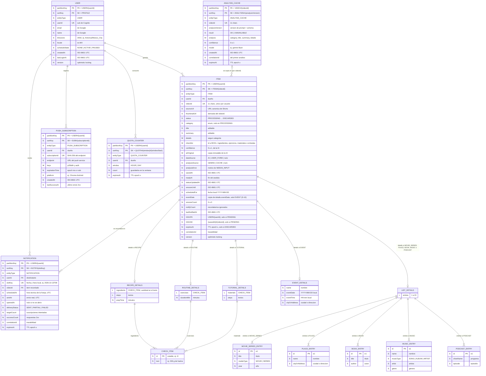

# Modelo de datos (DynamoDB Single-Table)

| Campo | Valor |
| --- | --- |
| Producto | Nudgee |
| Documento | Modelo de datos del MVP: diagrama E-R lógico y diseño físico en DynamoDB |
| Versión | 1.2 |
| Fecha | 15 de octubre de 2026 |
| Responsable | Sara Aranda |
| Contexto | Proyecto final de *Sistemas Escalables* (ITESO) — Entregable #4 |
| Estado | Confirmado |
| Documentos relacionados | `Nudgee_Requerimientos_Funcionales_MVP.md` (v1.4), `Nudgee_Requerimientos_No_Funcionales_MVP.md` (v1.3), `Nudgee_Contratos_API.md` (v1.1) |

## Historial de cambios

| Versión | Cambios |
| --- | --- |
| 0.1 | Borrador inicial: decisiones D-01…D-07, diagrama E-R, diccionario de entidades, llaves y patrones de acceso |
| 1.0 | Confirmado: GSI1 aceptado (D-08), efecto de D-04 aceptado y cambios de §8 aplicados en RF v1.2 y NFR v1.1 |
| 1.1 | Alineación con los contratos de API v1.0: AP-01 lo ejecuta un trigger *Post Authentication* de Cognito (API-09); nuevos AP-19 (`PATCH /me`) y AP-20 (`BatchGetItem` del polling, API-06); AP-03 aclara el orden de la paginación (API-12); restaurar reinicia `snoozeCount` y `notifyCount` (T-10) |
| 1.2 | Alineación con RF v1.4: subtipos de `details` para 10 categorías (Receta sin `servings` y con `steps`; Rutina, Tutorial, Evento y Música nuevas); listas `entries[]` en Película/serie, Lugar, Libro, Música y Podcast; checklist genérico (D-03); `eventDate` como atributo de primer nivel proyectado en GSI1 (D-10); caché global de análisis `ANALYSIS_CACHE` (D-09, AP-21, AP-22, §3.7); atributo `analysisSource`; AP-05, AP-07, AP-08 y AP-12 actualizados |

---

---

# 1. Decisiones de modelado

| ID | Decisión | Trade-off | Trazabilidad |
| --- | --- | --- | --- |
| D-01 | **Una sola tabla** (`nudgee-main`) para todas las entidades, agrupadas por `PK = USER#{userId}` | Un usuario = una *item collection*: el despachador y la biblioteca leen con un solo `Query`. A cambio, el esquema es menos autoexplicativo (por eso este E-R) | NFR-02, C-06 |
| D-02 | **Llave natural del ítem:** `SK = ITEM#{videoId}` | La deduplicación es un `PutItem` con `attribute_not_exists(PK)` (1 escritura, sin transacción). No se puede guardar dos veces el mismo video, que es justo lo que pide US-07 | US-07, T-01, NFR-03 |
| D-03 | **Checklist genérico como atributo aparte** (`checklist`, Map `id → BOOL`) para ingredientes, ejercicios, materiales y entradas de lista, actualizado sin incrementar `version` | Marcar en varios dispositivos no provoca conflictos `409` con ediciones. Si se editan los elementos, el checklist se recalcula conservando los `id` que sigan existiendo | US-26, US-32, US-45 |
| D-04 | **Abrir la tarjeta desde la push cuenta como respuesta** y reinicia `notifyCount` | Evita dormir ítems en los que el usuario sí mostró interés. Efecto aceptado: un ítem que se abre siempre sin actuar no pasa a `DORMANT`; solo lo limita el *cooldown*. Requiere la entidad `NOTIFICATION` | US-38, US-42, T-07 |
| D-05 | **Entidad `NOTIFICATION` con llave por franja** (`NOTIF#{slotKey}`) | La escritura condicional garantiza máx. 1 push por franja aunque el schedule se dispare dos veces (idempotencia). También da `scheduledAt` vs `sentAt` para NFR-04. Expira con TTL | US-37, NFR-04 |
| D-06 | **Cuota en Redis con respaldo en DynamoDB** (`QUOTA_COUNTER`) | Redis da la menor latencia en el camino crítico (p95 ≤ 300 ms); el contador en DynamoDB solo se usa si Redis no responde (*fail-soft*, mismo patrón que la deduplicación) | NFR-07, NFR-03 |
| D-07 | **Campos por categoría:** subtipos en el E-R, un solo atributo `details` (Map) en DynamoDB, con tres formas: (a) lista marcable (`ingredients`, `exercises`, `materials`); (b) `entries[]` de 1 a 20 obras; (c) plana (`EVENT`). Cada elemento marcable o entrada tiene un `id` estable asignado por el servidor | El diagrama es fácil de leer; físicamente se valida `details` contra el JSON Schema de la categoría | US-08, US-32, US-44, NFR-06 |
| D-08 | **Índice disperso `GSI1`** con los ítems `PENDING` (ver §4.2) | El despachador lee solo los elegibles, con una proyección pequeña, en vez de toda la biblioteca. Cuesta una escritura extra en el índice en cada entrada/salida de `PENDING`. La proyección incluye `eventDate` (D-10); como la infraestructura es efímera, recrear el índice no tiene costo | US-37–US-42, US-49, US-50, NFR-04, NFR-14 |
| D-09 | **Caché global de análisis** en la misma tabla: `PK = VIDEO#{videoId}`, `SK = ANALYSIS#v{analysisVersion}`. Cada usuario recibe una copia en su `ITEM`. La exclusión mutua la da SQS FIFO con `MessageGroupId = videoId`; la escritura condicional es una red de seguridad | Una lectura extra por análisis a cambio de evitar llamadas repetidas a Gemini. No vive en Redis porque el worker está fuera de la VPC (NFR-14). La partición de un video viral es caliente, pero muy por debajo del límite de 3,000 lecturas/s por partición. `analysisVersion` se incrementa al cambiar el prompt o el JSON Schema, para no reutilizar análisis con otra forma | C-03, C-04, NFR-01, NFR-02, T-02 |
| D-10 | **`eventDate` duplicado como atributo de primer nivel** (además de `details.eventDate`), solo en `EVENT` | Un GSI solo proyecta atributos de primer nivel, no rutas dentro de un Map. Ambos valores se escriben en la misma `UpdateExpression`, así que no pueden divergir | US-49, US-50, D-08 |

---

# 2. Diagrama entidad-relación (lógico)

Los tipos son los de DynamoDB: `S` (string), `N` (number), `BOOL`, `M` (map), `L` (list). En la columna de llaves, **PK** marca los atributos que forman la llave primaria (partition + sort key) y **FK** las referencias lógicas a otra entidad. DynamoDB no impone llaves foráneas: la integridad la garantiza la aplicación.

> En el diagrama, `partitionKey` y `sortKey` representan los atributos físicos `PK` y `SK` de la tabla (Mermaid reserva las palabras `PK`/`FK`/`UK` para marcar llaves y no permite usarlas como nombre de atributo).
> 

**Código fuente (Mermaid)** — editable; Notion también puede mostrarlo como vista previa.



**Cardinalidades clave**

- Un `USER` tiene 0..N `ITEM`, y cada `ITEM` pertenece a exactamente un `USER` (el `PK` es el mismo).
- Cada `ITEM` tiene 0..1 bloque de detalles: ninguno si es `OTHER` o si todavía está en `PROCESSING`/`NEEDS_INPUT`.
- En las categorías con lista (`MOVIE_SERIES`, `PLACE`, `BOOK`, `MUSIC`, `PODCAST`), `details` tiene de 1 a 20 entradas.
- Una `ANALYSIS_CACHE` se copia en 0..N `ITEM` de distintos usuarios. Es una relación lógica por `videoId`; DynamoDB no la impone.
- Una `NOTIFICATION` apunta a exactamente un `ITEM` (`videoId`). Si el ítem se elimina, la notificación queda huérfana hasta que expira por TTL; no afecta ninguna regla.
- `USER` ↔ `NOTIFICATION` está limitada a **una por franja** por la llave `NOTIF#{slotKey}` (US-37).

---

# 3. Diccionario de entidades

Convenciones:

- **Fechas-hora:** `S` en ISO-8601 UTC (`2026-10-13T15:00:00Z`), ordenables como texto.
- **Fechas locales:** `S` `YYYY-MM-DD` en la zona horaria del usuario (`scheduledFor`, porque reprogramar es "solo día", y `eventDate`).
- **TTL:** el único atributo TTL de la tabla es `expiresAt` (`N`, epoch en segundos). DynamoDB solo permite un atributo TTL por tabla, así que todas las entidades que caducan usan el mismo nombre.
- **`entityType`** en todos los registros, para distinguirlos en consultas, logs y el *seed script*.

## 3.1 USER — perfil

| Atributo | Tipo | Llave | Req. | Descripción / regla |
| --- | --- | --- | --- | --- |
| `PK` | S | Partition | Sí | `USER#{userId}` |
| `SK` | S | Sort | Sí | `PROFILE` (constante) |
| `userId` | S | Única | Sí | `sub` del JWT de Cognito; nunca se toma del request (NFR-05) |
| `email`, `name` | S | — | Sí | Únicos datos de Google que se guardan (NFR-08). Nunca van a logs |
| `timezone` | S | — | Sí | Zona IANA detectada en el cliente; se usa en el schedule y en `slotKey` (US-37) |
| `locale` | S | — | Sí | `es-MX` por defecto (NFR-13) |
| `scheduleState` | S | — | Sí | `NONE` (sin suscripción), `ACTIVE`, `PAUSED` (sin pendientes o sin suscripciones) |
| `createdAt`, `lastLoginAt` | S | — | Sí | ISO-8601 UTC |
| `version` | N | — | Sí | *Optimistic locking* |

El nombre del schedule de EventBridge es determinístico (`nudgee-{userId}`), por eso no se guarda.

## 3.2 ITEM — video guardado

| Atributo | Tipo | Llave | Req. | Descripción / regla |
| --- | --- | --- | --- | --- |
| `PK` | S | Partition | Sí | `USER#{userId}` |
| `SK` | S | Sort | Sí | `ITEM#{videoId}` (D-02) |
| `videoId` | S | Única por usuario | Sí | 11 caracteres `[A-Za-z0-9_-]` |
| `sourceUrl` | S | — | Sí | `https://www.youtube.com/shorts/{videoId}`, reconstruida (NFR-06) |
| `thumbnailUrl` | S | — | Sí | `https://i.ytimg.com/vi/{videoId}/hqdefault.jpg` |
| `status` | S | — | Sí | `PROCESSING`, `NEEDS_INPUT`, `PENDING`, `DORMANT`, `DONE`, `DISCARDED` (§4 RF) |
| `category` | S | — | No | `RECIPE`, `ROUTINE`, `TUTORIAL`, `MOVIE_SERIES`, `PLACE`, `BOOK`, `MUSIC`, `PODCAST`, `EVENT`, `OTHER`; nulo mientras no haya datos |
| `title`, `summary` | S | — | No | Editables (US-31) |
| `details` | M | — | No | Campos de la categoría (§3.6); validado contra el JSON Schema (NFR-06) |
| `checklist` | M | — | No | `{ "i1": true, "e3": false }`; solo en categorías con elementos marcables o con lista; no incrementa `version` (D-03) |
| `confidence` | N | — | No | 0–1, reportada por Gemini |
| `aiOriginal` | M | — | No | `{category, title, summary, details}` tal como salió de la IA (de Gemini o copiado de la caché); inmutable |
| `dataSource` | S | — | No | `AI` o `USER_FORM`; nulo = nunca tuvo datos → al restaurar va a `NEEDS_INPUT` (T-10) |
| `analysisSource` | S | — | No | `GEMINI` o `CACHE`; nulo si los datos vienen del formulario. Alimenta la métrica de aciertos de la caché (NFR-10) |
| `analysisError` | S | — | No | `AI_ERROR`, `INVALID_OUTPUT`, `RETRIES_EXHAUSTED`, `VIDEO_UNAVAILABLE` |
| `savedAt` | S | — | Sí | Ordena por antigüedad (US-39) |
| `readyAt` | S | — | No | Para medir `savedAt → readyAt` (NFR-01) |
| `statusUpdatedAt` | S | — | Sí | Última transición |
| `snoozeUntil` | S | — | No | Fecha-hora UTC (no fecha local) para que la duración sea configurable en minutos en la demo (NFR-11) |
| `scheduledFor` | S | — | No | Fecha local del usuario (US-20, US-40) |
| `eventDate` | S | GSI1 (proyección) | No | Solo `EVENT`. Copia de `details.eventDate` escrita en la misma `UpdateExpression` (D-10) |
| `snoozeCount` | N | — | Sí | Al llegar a 3 se sugiere descartar (US-21); restaurar lo reinicia a 0 (T-10) |
| `notifyCount` | N | — | Sí | Recordatorios **ignorados**; abrir desde la push o restaurar lo reinicia a 0 (D-04, T-10); 3 → `DORMANT` (T-07) |
| `lastNotifiedAt` | S | — | No | *Cooldown* (US-41) |
| `GSI1PK`, `GSI1SK` | S | GSI1 | No | Solo existen en `PENDING` (D-08) |
| `expiresAt` | N | TTL | No | `discardedAt + 30 días`; se elimina al restaurar (T-12, US-43) |
| `correlationId` | S | — | Sí | Del request de guardado; se propaga a SQS y al worker (NFR-10) |
| `version` | N | — | Sí | Lo incrementan las transiciones y ediciones |

## 3.3 PUSH_SUBSCRIPTION

| Atributo | Tipo | Llave | Req. | Descripción / regla |
| --- | --- | --- | --- | --- |
| `PK` | S | Partition | Sí | `USER#{userId}` |
| `SK` | S | Sort | Sí | `SUB#{subscriptionId}` |
| `subscriptionId` | S | Única | Sí | SHA-256 hex del `endpoint`: llave de longitud fija; re-suscribir el mismo navegador sobrescribe en vez de duplicar |
| `endpoint` | S | — | Sí | URL del push service (FCM, Mozilla, Apple) |
| `keys` | M | — | Sí | `{ p256dh: S, auth: S }` |
| `expirationTime` | N | — | No | Del `PushSubscription` del navegador |
| `platform` | S | — | No | Etiqueta corta (navegador + SO), solo para soporte |
| `createdAt`, `lastSuccessAt` | S | — | Sí / No | ISO-8601 UTC |

Un `404`/`410` borra el registro en la misma ejecución (NFR-04). Si era la última suscripción, `USER.scheduleState = PAUSED`.

## 3.4 NOTIFICATION — recordatorio enviado

| Atributo | Tipo | Llave | Req. | Descripción / regla |
| --- | --- | --- | --- | --- |
| `PK` | S | Partition | Sí | `USER#{userId}` |
| `SK` | S | Sort | Sí | `NOTIF#{slotKey}` |
| `slotKey` | S | Única por usuario | Sí | Fecha y hora local de la franja: `2026-10-13T09` |
| `videoId` | S | FK → ITEM | Sí | Ítem elegido por el motor |
| `scheduledAt`, `sentAt` | S | — | Sí | Para medir el retraso de envío (NFR-04) |
| `openedAt` | S | — | No | Se escribe al abrir la tarjeta desde la push (D-04) |
| `deliveryStatus` | S | — | Sí | `SENT` (todas 2xx), `PARTIAL`, `FAILED` |
| `targetCount`, `successCount` | N | — | Sí | Tasa de éxito de push del dashboard (NFR-10) |
| `correlationId` | S | — | Sí | Scheduler → despachador → push |
| `expiresAt` | N | TTL | Sí | `sentAt + 30 días` (configurable) |

## 3.5 QUOTA_COUNTER — respaldo de la cuota

| Atributo | Tipo | Llave | Req. | Descripción / regla |
| --- | --- | --- | --- | --- |
| `PK` | S | Partition | Sí | `USER#{userId}` |
| `SK` | S | Sort | Sí | `QUOTA#HOUR#2026-10-13T15` o `QUOTA#DAY#2026-10-13` (ventanas fijas en UTC) |
| `window` | S | — | Sí | `HOUR` o `DAY` |
| `count` | N | — | Sí | `ADD count 1` condicionado a `count < límite` |
| `expiresAt` | N | TTL | Sí | Fin de la ventana + 1 h |

Solo se escribe cuando Redis no responde (D-06).

## 3.6 Subtipos de `details` (por categoría)

| Categoría | Atributo | Tipo | Req. | Notas |
| --- | --- | --- | --- | --- |
| `RECIPE` | `ingredients` | L de M | Sí | `{ id, text }`; la cantidad va en el texto |
|  | `steps` | L de S | No | Se muestran numerados |
|  | `prepTime` | N | No | Minutos |
| `ROUTINE` | `exercises` | L de M | Sí | `{ id, text }`, ej. "3×12 sentadillas" |
|  | `durationMin` | N | No | Minutos |
| `TUTORIAL` | `materials` | L de M | Sí | `{ id, text }` |
|  | `steps` | L de S | No |  |
| `EVENT` | `name` | S | Sí |  |
|  | `eventDate` | S | No | `YYYY-MM-DD` local; se copia en el atributo de primer nivel (D-10) |
|  | `eventTime` | S | No | `HH:mm` local |
|  | `cityOrAddress` | S | No |  |
| `MOVIE_SERIES` | `entries` | L de M | Sí (1–20) | `{ id, title*, mediaType*, year }`; `mediaType` es `MOVIE` o `SERIES` |
| `PLACE` | `entries` | L de M | Sí (1–20) | `{ id, name*, cityOrAddress }` |
| `BOOK` | `entries` | L de M | Sí (1–20) | `{ id, title*, author }` |
| `MUSIC` | `entries` | L de M | Sí (1–20) | `{ id, name*, musicType*, artist, genre }`; `musicType` es `SONG`, `ALBUM` o `ARTIST` |
| `PODCAST` | `entries` | L de M | Sí (1–20) | `{ id, showName*, episode }` |
| `OTHER` | — | — | — | Sin `details` |

* obligatorio dentro de la entrada.

Los IDs usan el prefijo `i` en las listas marcables y `e` en las entradas; los asigna el servidor al validar, y el checklist se indexa por ellos. Límites preliminares: hasta 50 elementos marcables, 30 pasos y 20 entradas.

La obligatoriedad final se define en los JSON Schemas (entregable #5).

## 3.7 ANALYSIS_CACHE — caché global de análisis

| Atributo | Tipo | Llave | Req. | Descripción / regla |
| --- | --- | --- | --- | --- |
| `PK` | S | Partition | Sí | `VIDEO#{videoId}`. Partición global, fuera de las colecciones de usuario |
| `SK` | S | Sort | Sí | `ANALYSIS#v{analysisVersion}` |
| `analysisVersion` | N | — | Sí | Versión del prompt + JSON Schema (configurable); se incrementa al cambiar cualquiera de los dos |
| `result` | S | — | Sí | `OK` o `UNAVAILABLE` (caché negativa) |
| `analysis` | M | — | Si `OK` | `{category, title, summary, details}` con los IDs ya asignados |
| `confidence` | N | — | Si `OK` | Solo se guarda si es ≥ 0.7 (configurable) |
| `model` | S | — | Sí | Modelo de Gemini usado, para trazabilidad |
| `createdAt` | S | — | Sí | ISO-8601 UTC |
| `correlationId` | S | — | Sí | Del análisis que la creó (NFR-10) |
| `expiresAt` | N | TTL | Sí | `OK`: +90 días; `UNAVAILABLE`: +1 h (ambos configurables) |

No contiene PII: se deriva de un video público y de un prompt sin datos del usuario. `AI_ERROR` e `INVALID_OUTPUT` no se guardan.

---

# 4. Diseño físico

## 4.1 Tabla `nudgee-main`

| Propiedad | Valor | Justificación |
| --- | --- | --- |
| Llave primaria | `PK` (S, partition) + `SK` (S, sort) | Single-table (D-01) |
| Capacidad | On-demand | Pay-per-use, picos de 30 guardados/s (NFR-02, NFR-14) |
| TTL | `expiresAt` | T-12, notificaciones, cuotas y caché de análisis |
| Cifrado | SSE con llave administrada por AWS | NFR-08, sin costo extra |
| Streams | No | Ningún flujo lo necesita en el MVP |
| PITR | No en el MVP / Sí en producción | C-02 (infra efímera); RPO ≤ 5 min en producción |

**Distribución de una item collection**

| PK | SK | Entidad |
| --- | --- | --- |
| `USER#a1b2…` | `ITEM#dQw4w9WgXcQ` | ITEM |
| `USER#a1b2…` | `NOTIF#2026-10-13T09` | NOTIFICATION |
| `USER#a1b2…` | `PROFILE` | USER |
| `USER#a1b2…` | `QUOTA#DAY#2026-10-13` | QUOTA_COUNTER |
| `USER#a1b2…` | `SUB#9f86d08…` | PUSH_SUBSCRIPTION |

Fuera de las colecciones de usuario existe una partición global por video para la caché de análisis (D-09):

| PK | SK | Entidad |
| --- | --- | --- |
| `VIDEO#dQw4w9WgXcQ` | `ANALYSIS#v1` | ANALYSIS_CACHE |

Su llave nunca se construye con datos del request: el `videoId` lo extrae el servidor del link validado.

Los prefijos permiten leer cada tipo con `begins_with(SK, …)`. La partición queda acotada por usuario (decenas o cientos de registros), muy lejos del límite de 10 GB por *item collection* (aplica solo con LSI, que no usamos).

## 4.2 GSI1 — ítems elegibles para recordatorio (índice disperso)

| Propiedad | Valor |
| --- | --- |
| Partition key | `GSI1PK` = `USER#{userId}` |
| Sort key | `GSI1SK` = `{savedAt}#{videoId}` (del más viejo al más nuevo, US-39) |
| Proyección | `INCLUDE`: `videoId`, `title`, `category`, `snoozeUntil`, `scheduledFor`, `notifyCount`, `lastNotifiedAt`, `eventDate` |
| Escritura | Toda transición **hacia** `PENDING` hace `SET GSI1PK, GSI1SK`; toda transición **desde** `PENDING` hace `REMOVE` en la misma `UpdateExpression` |

El despachador obtiene los candidatos con un `Query` a GSI1 y aplica el motor (funciones puras) en memoria. La lectura es eventualmente consistente, pero la escritura final es condicional sobre la tabla base (`status = PENDING`), así que un dato desfasado nunca produce un envío inválido.

---

# 5. Patrones de acceso

| ID | Patrón | Operación | Llave / condición | Trazabilidad |
| --- | --- | --- | --- | --- |
| AP-01 | Crear o actualizar perfil al iniciar sesión (trigger *Post Authentication* de Cognito) | `UpdateItem` (upsert) | `PROFILE` | US-01, API-09 |
| AP-02 | Guardar link sin duplicar | `PutItem` | `ITEM#{videoId}`, `attribute_not_exists(PK)` | US-04, US-07, T-01 |
| AP-03 | Listar biblioteca (paginada por cursor) | `Query` | `PK`, `begins_with(SK, "ITEM#")`; excluye `expiresAt` vencido. El orden es por `videoId` (SK), no cronológico; el cliente ordena por `savedAt` | US-11–US-14, API-12 |
| AP-04 | Ver tarjeta | `GetItem` | `ITEM#{videoId}` | US-16, US-38 |
| AP-05 | Worker guarda resultado (de Gemini o copiado de la caché) | `UpdateItem` | `status = PROCESSING`; `SET analysisSource` y, si es `EVENT`, `SET eventDate` | T-02, T-03, D-09 |
| AP-06 | Transición de usuario | `UpdateItem` | `status IN (...)` y `version = :v` | T-04–T-10 |
| AP-07 | Editar ítem | `UpdateItem` | `status IN (PENDING, DORMANT)` y `version = :v`. Si es `EVENT`, `SET eventDate` junto con `details`; si cambia a otra categoría, `REMOVE eventDate` | US-31–US-34, D-10 |
| AP-08 | Marcar elemento o entrada | `UpdateItem` `SET checklist.#id` | `category` distinta de `EVENT` y `OTHER`, `status IN (PENDING, DORMANT)` | US-26, US-45 |
| AP-09 | Eliminar definitivo | `DeleteItem` | `status = DISCARDED` | T-11 |
| AP-10 | Registrar suscripción | `PutItem` | `SUB#{hash}` | US-35 |
| AP-11 | Borrar suscripción expirada | `DeleteItem` | `SUB#{hash}` | NFR-04 |
| AP-12 | Despachador: contexto del usuario | `GetItem`, `Query`, `Query GSI1` y `GetItem` | `PROFILE`; `begins_with(SK, "SUB#")`; GSI1; `GetItem` del ítem elegido para el texto de la notificación (progreso de la lista), en vez de proyectar `details` y `checklist` en GSI1 | US-37–US-41, US-50 |
| AP-13 | Registrar envío (idempotente) | `TransactWriteItems` | `Put NOTIF#{slotKey}` con `attribute_not_exists`, en la misma transacción que `Update ITEM` (`notifyCount + 1`, `lastNotifiedAt`) con `status = PENDING` | US-37, US-41 |
| AP-14 | Abrir desde la push | `TransactWriteItems` | `Update NOTIF` (`openedAt`, si no existe) + `Update ITEM` (`notifyCount = 0`) | US-38, D-04 |
| AP-15 | Pasar a dormido | `UpdateItem` | `status = PENDING` y `notifyCount >= 3`; `REMOVE GSI1PK, GSI1SK` | T-07, US-42 |
| AP-16 | Cuota (respaldo) | `UpdateItem` `ADD count` | `count < límite` | NFR-07 |
| AP-17 | Pausar / reanudar schedule | `UpdateItem` | `PROFILE.scheduleState` | §5 RF |
| AP-18 | Auto-borrado de descartados | TTL | `expiresAt` | T-12, US-43 |
| AP-19 | Actualizar zona horaria / locale | `UpdateItem` | `PROFILE` (`SET timezone, locale`) | US-37, API-09 |
| AP-20 | Polling de ítems en análisis | `BatchGetItem` | Hasta 25 llaves `ITEM#{videoId}` del mismo `PK` | US-09, API-06 |
| AP-21 | Leer la caché de análisis | `GetItem` (consistente) | `VIDEO#{videoId}` / `ANALYSIS#v{n}`; se ignora si `expiresAt` ya venció | D-09 |
| AP-22 | Guardar en la caché de análisis | `PutItem` | `attribute_not_exists(PK) OR expiresAt < :now` | D-09 |

---

# 6. Datos fuera de DynamoDB (ElastiCache Redis)

| Llave | Comando | TTL | Uso |
| --- | --- | --- | --- |
| `dedupe:{userId}:{videoId}` | `SET NX EX` | Corto (p. ej. 5 min) | Corta en seco los guardados concurrentes idénticos; DynamoDB (AP-02) sigue siendo la fuente de verdad (NFR-03) |
| `quota:{userId}:h:{yyyyMMddHH}` | `INCR` y `EXPIRE` | 1 h | Cuota de 30 por hora (NFR-07) |
| `quota:{userId}:d:{yyyyMMdd}` | `INCR` y `EXPIRE` | 24 h | Cuota de 100 por día (NFR-07) |

Si Redis no responde, AP-02 y AP-16 cubren ambas funciones con mayor latencia.

Las llaves `dedupe:` son **por usuario**. La caché de análisis es global y vive en DynamoDB (D-09, §3.7), porque el worker de IA está fuera de la VPC.

---

# 7. Ejemplos de registro

## 7.1 ITEM de receta

```json
{
  "PK": "USER#a1b2c3d4-0000-4000-8000-000000000001",
  "SK": "ITEM#dQw4w9WgXcQ",
  "entityType": "ITEM",
  "userId": "a1b2c3d4-0000-4000-8000-000000000001",
  "videoId": "dQw4w9WgXcQ",
  "sourceUrl": "https://www.youtube.com/shorts/dQw4w9WgXcQ",
  "thumbnailUrl": "https://i.ytimg.com/vi/dQw4w9WgXcQ/hqdefault.jpg",
  "status": "PENDING",
  "category": "RECIPE",
  "title": "Pasta cremosa de un solo sartén",
  "summary": "Pasta con ajo, crema y parmesano lista en 20 minutos.",
  "details": {
    "ingredients": [
      { "id": "i1", "text": "250 g de pasta corta" },
      { "id": "i2", "text": "2 dientes de ajo" },
      { "id": "i3", "text": "200 ml de crema" }
    ],
    "steps": [
      "Cuece la pasta en agua con sal.",
      "Sofríe el ajo y agrega la crema.",
      "Mezcla la pasta con la salsa."
    ],
    "prepTime": 20
  },
  "checklist": { "i1": true, "i2": false, "i3": false },
  "confidence": 0.92,
  "dataSource": "AI",
  "analysisSource": "GEMINI",
  "savedAt": "2026-10-10T18:02:11Z",
  "readyAt": "2026-10-10T18:02:29Z",
  "statusUpdatedAt": "2026-10-10T18:02:29Z",
  "snoozeCount": 0,
  "notifyCount": 1,
  "lastNotifiedAt": "2026-10-12T15:01:40Z",
  "GSI1PK": "USER#a1b2c3d4-0000-4000-8000-000000000001",
  "GSI1SK": "2026-10-10T18:02:11Z#dQw4w9WgXcQ",
  "correlationId": "01JA8Z3K5X2V7Q9R4T6Y8W0E1M",
  "version": 3
}
```

(`aiOriginal` se omite por brevedad.)

## 7.2 ITEM con lista

```json
{
  "PK": "USER#a1b2c3d4-0000-4000-8000-000000000001",
  "SK": "ITEM#kL9mN1pQ3rS",
  "entityType": "ITEM",
  "status": "PENDING",
  "category": "MOVIE_SERIES",
  "title": "5 películas de terror para Halloween",
  "details": {
    "entries": [
      { "id": "e1", "title": "El conjuro", "mediaType": "MOVIE", "year": 2013 },
      { "id": "e2", "title": "Hereditary", "mediaType": "MOVIE", "year": 2018 }
    ]
  },
  "checklist": { "e1": true },
  "dataSource": "AI",
  "analysisSource": "CACHE",
  "version": 2
}
```

(Se omiten los atributos comunes.)

## 7.3 ANALYSIS_CACHE

```json
{
  "PK": "VIDEO#kL9mN1pQ3rS",
  "SK": "ANALYSIS#v1",
  "entityType": "ANALYSIS_CACHE",
  "videoId": "kL9mN1pQ3rS",
  "analysisVersion": 1,
  "result": "OK",
  "analysis": {
    "category": "MOVIE_SERIES",
    "title": "5 películas de terror para Halloween",
    "summary": "Recomendaciones de terror para ver en octubre.",
    "details": { "entries": [ { "id": "e1", "title": "El conjuro", "mediaType": "MOVIE", "year": 2013 } ] }
  },
  "confidence": 0.88,
  "model": "gemini-flash",
  "createdAt": "2026-10-14T18:00:00Z",
  "correlationId": "01JA9B2C3D4E5F6G7H8J9K0M1N",
  "expiresAt": 1792094400
}
```

---

# 8. Cambios aplicados a otros documentos

| Documento | Cambio | Motivo |
| --- | --- | --- |
| RF v1.1 → v1.2 | §4.3, §4.5 y §5: definir "respuesta" = abrir la tarjeta desde la notificación (reinicia `notifyCount`) e idempotencia de un envío por franja; agregar `dataSource`, `readyAt` y `checklist` en §3.2 | D-03, D-04, D-05 |
| RF v1.1 → v1.2 | §3.1: `prepTime` en minutos (`N`) e `ingredients` como lista de `{id, text}` | D-03, D-07 |
| RF v1.1 → v1.2 | §3.2 dice que se edita en `NEEDS_INPUT`, pero §4.4 marca "Editar ✘" en ese estado (solo "Llenar formulario"). Aclarar que en `NEEDS_INPUT` la única escritura es el formulario | Consistencia |
| NFR v1.0 → v1.1 | §7: "la tabla de suscripciones" pasa a "la tabla única, incluidos los registros de suscripciones push"; NFR-01 mide `savedAt → readyAt` | D-01, nombres del modelo |
| RF v1.3 → v1.4 | Categorías, listas, reglas de eventos y T-02 con caché *(aplicado)* | D-07, D-09, D-10 |
| API v1.0 → v1.1 | Enum de 10 categorías; `analysisSource` y `suggestDone` en el recurso `Item` (la copia de primer nivel de `eventDate` queda interna); E-18 genérico (`UNKNOWN_CHECKLIST_ITEM`); límites de E-08 *(aplicado)* | D-03, D-07, D-09, D-10 |
| NFR v1.2 → v1.3 | Caché global y SQS FIFO; schedule group; métrica de aciertos de la caché; prueba de N usuarios con el mismo video *(aplicado)* | D-09 |