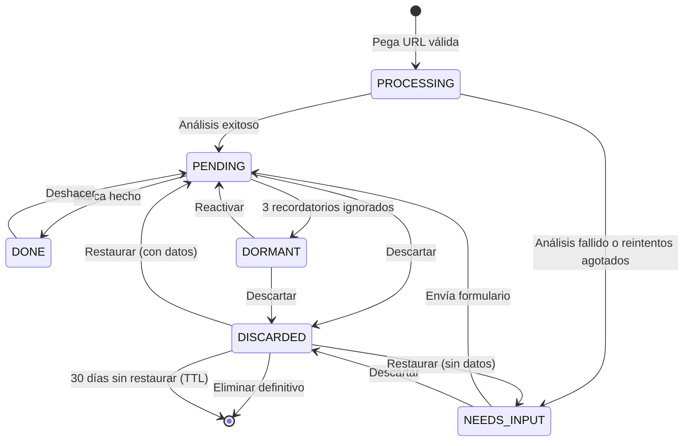

# Requerimientos funcionales (MVP)

| Campo | Valor |
| --- | --- |
| Producto | Nudgee |
| Documento | Requerimientos funcionales del MVP |
| Versión | 1.4 |
| Fecha | 15 de octubre de 2026 |
| Responsable | Sara Aranda |
| Contexto | Proyecto final de *Sistemas Escalables* (ITESO) |
| Estado | Confirmado |

## Historial de cambios

| Versión | Cambios |
| --- | --- |
| 1.0 | Versión inicial confirmada |
| 1.1 | US-43 y T-12 (auto-borrado de descartados a 30 días, atributo `expiresAt`); campo `videoId` y URL canónica; criterios de límite de guardados (US-04) y actualización por polling (US-09); valores del motor de recordatorios como defaults configurables; regla de suscripciones expiradas; aviso de privacidad al backlog |
| 1.2 | Alineación con el modelo de datos v1.0: definición de "respuesta" a un recordatorio (abrir la tarjeta desde la notificación reinicia `notifyCount`, T-07 y §5); regla de idempotencia de un envío por franja; `ingredients` como lista de `{id, text}` y `prepTime` en minutos; atributos `checklist`, `dataSource` y `readyAt`; aclaración de que en `NEEDS_INPUT` la única escritura es el formulario |
| 1.3 | Alineación con los contratos de API v1.0: posponer y reprogramar son excluyentes (§4.5, API-11); restaurar reinicia `notifyCount` y `snoozeCount` (T-10, §4.5) |
| 1.4 | Refinamiento de categorías: se agregan Rutina, Tutorial, Evento y Música (Evento sale del backlog); Receta quita `servings` y agrega `steps`; listas de varias recomendaciones (`entries[]`) en Película/serie, Lugar, Libro, Música y Podcast; checklist genérico; reglas de clasificación (§3.3); reglas de eventos en el motor de recordatorios; T-02 admite la caché global de análisis; schedules dentro de un grupo gestionado por Terraform; nuevas US-44…US-50; US-26, US-28 y US-30 generalizadas |

---

---

# 1. Resumen del alcance

| Tema | Decisión del MVP |
| --- | --- |
| Plataforma | PWA responsiva móvil-first. Instalación **recomendada, no obligatoria** |
| Autenticación | Google SSO mediante **Amazon Cognito** (sesión de hasta 30 días) |
| Fuente de contenido | Solo **YouTube Shorts** (Gemini lee la URL directamente) |
| Ingesta | Única vía: **pegar la URL manualmente** (Android, iOS y escritorio) |
| Análisis | Gemini Flash con salida JSON Schema y **caché global por video** (un análisis se reutiliza entre usuarios); si falla, formulario generado desde el mismo schema |
| Categorías | 10: Receta, Rutina, Tutorial, Película/serie, Lugar/restaurante, Libro, Música, Podcast, Evento, Otro |
| Listas | Un video con varias recomendaciones se guarda como **un ítem con lista** (máx. 20 entradas) |
| Recordatorios | Máx. 3 por día en franjas fijas; máx. 3 por ítem, luego pasa a Dormido |
| Biblioteca | Colecciones automáticas (filtros por categoría y estado) y búsqueda en el cliente |
| Retención | Los ítems descartados se eliminan automáticamente a los 30 días |
| Onboarding | No se programa; la instalación se explica de forma presencial |

---

# 2. User stories

## Epic 1 — Authentication

| ID | User story |
| --- | --- |
| US-01 | As a user, I want to sign in with my Google account so I can start using the app without creating a new password. |
| US-02 | As a user, I want my session to stay active for up to 30 days so I can open the app from a reminder without signing in again. |
| US-03 | As a user, I want to sign out so I can protect my account on a shared device. |

## Epic 2 — Capture

| ID | User story |
| --- | --- |
| US-04 | As a user, I want to paste a YouTube Shorts link so I can save a video I want to act on later. |
| US-05 | As a user, I want to get an immediate confirmation after pasting a link so I can keep doing what I was doing without waiting for the analysis. |
| US-06 | As a user, I want to be told when a link is not a valid YouTube Shorts URL so I can correct it. |
| US-07 | As a user, I want to be warned when I try to save a video I already saved so I don't end up with duplicates. |
| US-08 | As a user, I want the app to automatically categorize each video and extract its key information so I don't have to type it myself. |
| US-09 | As a user, I want to see when a saved video is still being analyzed so I know its information isn't ready yet. |
| US-10 | As a user, I want to choose a category and fill a short form when a video can't be analyzed so I can still keep it and get reminders. |

**Criterios de aceptación adicionales**

- **US-04 · Límite de guardados:** al exceder la cuota por usuario (30 por hora, 100 por día) no se guarda el link y se muestra *"Llegaste al límite de guardados. Intenta de nuevo en X min"*, calculado con la respuesta `429` + `Retry-After` (ver NFR-07).
- **US-09 · Actualización automática:** mientras haya ítems en `PROCESSING`, la biblioteca consulta su estado cada 3–5 s (polling). El polling se detiene cuando ya no hay ítems en análisis o después de 2 min; la tarjeta pasa a `PENDING` o `NEEDS_INPUT` sin recargar la página.

## Epic 3 — Library

| ID | User story |
| --- | --- |
| US-11 | As a user, I want to see all my saved items with their thumbnail, title and category so I can get an overview of what I've saved. |
| US-12 | As a user, I want to filter my items by category so I can focus on one type of content at a time. |
| US-13 | As a user, I want to filter my items by status (pending, needs input, dormant, done, discarded) so I can find items at any stage. |
| US-14 | As a user, I want to search my items by title or summary so I can quickly find a specific one. |
| US-15 | As a user, I want to open the original video on YouTube so I can watch it again. |

## Epic 4 — Item card and actions

| ID | User story |
| --- | --- |
| US-16 | As a user, I want to see an item card with its summary and category-specific details so I have everything I need to act on it. |
| US-17 | As a user, I want to mark an item as done with a category-specific label (e.g., "I cooked it") so I can feel I've completed it. |
| US-18 | As a user, I want to undo a "done" item so I can fix a mistake. |
| US-19 | As a user, I want to snooze an item for 1, 3 or 5 days so I can postpone it when it's not a good moment. |
| US-20 | As a user, I want to reschedule an item for a specific day so I can be reminded exactly when I plan to do it. |
| US-21 | As a user, I want to get a suggestion to discard an item after snoozing it 3 times so I can clean up things I'm unlikely to do. |
| US-22 | As a user, I want to discard an item so I stop being reminded about it. |
| US-23 | As a user, I want to restore a discarded item so I can recover it if I change my mind. |
| US-24 | As a user, I want to permanently delete a discarded item after confirming so I can remove it for good. |
| US-25 | As a user, I want to reactivate a dormant item so I can start getting reminders about it again. |
| US-43 | As a user, I want discarded items to be deleted automatically after 30 days so my library stays clean. |
| US-44 | As a user, I want a video that recommends several movies, books, songs, podcasts or places to be saved as a single list so I can keep them together without getting extra reminders. |
| US-45 | As a user, I want to check off each entry of a list (e.g., "I watched it") so I can track my progress. |
| US-46 | As a user, I want to get a suggestion to mark a list as done when I've checked every entry so I can close it easily. |

**Criterios de aceptación adicionales**

- **US-43:** la tarjeta de un ítem descartado muestra *"Se eliminará en X días"*. Restaurarlo (US-23) cancela el borrado automático.
- **US-44 · Listas:** una sola obra es una lista de 1 entrada y se ve como la tarjeta normal. Con más de una, la tarjeta muestra la lista, el progreso *"X de N"* y la acción de categoría **por entrada** (p. ej., "Dónde verla" para cada película). Máximo 20 entradas; el usuario puede agregar o quitar entradas al editar (US-32). El candidato a recordatorio sigue siendo el ítem, no cada entrada.
- **US-46:** la sugerencia aparece cuando todas las entradas están marcadas. No es bloqueante y no cambia el estado de forma automática.

**Category-specific actions**

| ID | User story |
| --- | --- |
| US-26 | As a user, I want a checklist from a recipe's ingredients, a routine's exercises or a tutorial's materials, saved across my devices, so I can track what I have or what I've done. |
| US-27 | As a user, I want to find where to watch a movie or series so I can start watching it right away. |
| US-28 | As a user, I want to open a place or an event's location in Google Maps so I can see how to get there. |
| US-29 | As a user, I want to search for a book online so I can get it or read more about it. |
| US-30 | As a user, I want to open a podcast, song, album or artist in Spotify so I can start listening right away. |
| US-47 | As a user, I want to add an event to my calendar so I don't miss it. |
| US-48 | As a user, I want to search for tickets for an event so I can get them. |

**Criterios de aceptación adicionales**

- **US-47:** solo está disponible si el evento tiene `eventDate`. Se ofrece un enlace a Google Calendar y un archivo `.ics` generado en el cliente para otros calendarios.
- **US-48:** abre una búsqueda web con el nombre y la ciudad del evento; nunca un link escrito por la IA o por el usuario (NFR-06).

## Epic 5 — Editing

| ID | User story |
| --- | --- |
| US-31 | As a user, I want to edit an item's title and summary so I can fix what the AI got wrong. |
| US-32 | As a user, I want to edit an item's category-specific fields (e.g., add or remove ingredients) so its information is accurate. |
| US-33 | As a user, I want to change an item's category and fill in the new category's form so the item is correctly classified. |
| US-34 | As a user, I want editing to be disabled while an item is being analyzed so my changes aren't overwritten. |

## Epic 6 — Reminders

| ID | User story |
| --- | --- |
| US-35 | As a user, I want to enable reminders from a banner in my library so I can start receiving notifications. |
| US-36 | As an iOS user, I want instructions to install the app on my home screen so I can receive reminders. |
| US-37 | As a user, I want to receive at most 3 reminders per day at fixed times in my time zone so I don't feel overwhelmed. |
| US-38 | As a user, I want a reminder to open the item's card when I tap it so I can act on it immediately. |
| US-39 | As a user, I want my oldest saved items to be reminded first so they don't get forgotten. |
| US-40 | As a user, I want rescheduled items to have priority on their chosen day so I'm reminded when I planned. |
| US-41 | As a user, I don't want to be reminded about the same item more than once every 3 days so reminders don't feel repetitive. |
| US-42 | As a user, I want items I've ignored 3 times to stop being reminded and move to "dormant" so I'm not bothered by things I'm not interested in. |
| US-49 | As a user, I don't want to be reminded about an event that already happened. |
| US-50 | As a user, I want upcoming events to be reminded before other items so I can plan to attend. |

**Criterios de aceptación adicionales**

- **US-49 / US-50:** `eventDate` es opcional; sin fecha, la tarjeta muestra *"Fecha por confirmar"* y el evento compite como cualquier ítem. Si la fecha ya pasó en la zona horaria del usuario, el evento no es elegible y la tarjeta muestra *"Este evento ya pasó"* con la sugerencia de descartar. Los eventos con fecha en los próximos 7 días tienen prioridad después de los reprogramados (§5).

---

# 3. Categorías

## 3.1 Catálogo

| Enum | Etiqueta UI | Campos específicos | Lista | Checklist | Acción específica | Implementación | Botón "Hecho" |
| --- | --- | --- | --- | --- | --- | --- | --- |
| `RECIPE` | Receta | `ingredients[]` (`{id, text}`, cantidad incluida en el texto), `steps[]`, `prepTime` (minutos) | No | Ingredientes | Lista de compras | Checklist con progreso guardado en el servidor | "Ya la cociné" |
| `ROUTINE` | Rutina | `exercises[]` (`{id, text}`, ej. "3×12 sentadillas"), `durationMin` | No | Ejercicios | Checklist de ejercicios | Checklist con progreso guardado en el servidor | "Ya la hice" |
| `TUTORIAL` | Tutorial | `materials[]` (`{id, text}`), `steps[]` | No | Materiales | Lista de materiales | Checklist con progreso guardado en el servidor | "Ya lo hice" |
| `MOVIE_SERIES` | Película o serie | Por entrada: `title`, `mediaType`, `year` | Sí | Entradas | Dónde verla | Link de búsqueda por entrada (JustWatch) | "Ya la vi" |
| `PLACE` | Lugar o restaurante | Por entrada: `name`, `cityOrAddress` | Sí | Entradas | Abrir en Maps | Link de búsqueda por entrada (Google Maps) | "Ya fui" |
| `BOOK` | Libro | Por entrada: `title`, `author` | Sí | Entradas | Buscar libro | Link de búsqueda por entrada (Google Books) | "Ya lo leí" |
| `MUSIC` | Música | Por entrada: `name`, `musicType` (`SONG`, `ALBUM` o `ARTIST`), `artist`, `genre` | Sí | Entradas | Escuchar | Link de búsqueda por entrada (Spotify) | "Ya lo escuché" |
| `PODCAST` | Podcast | Por entrada: `showName`, `episode` | Sí | Entradas | Escuchar | Link de búsqueda por entrada (Spotify) | "Ya lo escuché" |
| `EVENT` | Evento | `name`, `eventDate` (opcional), `eventTime` (opcional), `cityOrAddress` | No | — | Abrir en Maps · Agregar a calendario · Buscar boletos | Links de búsqueda (Google Maps y búsqueda web) y evento de calendario (Google Calendar o `.ics` generado en el cliente) | "Ya fui" |
| `OTHER` | Otro | — | No | — | Ninguna | Solo acciones comunes | "Hecho" |
- **Listas (US-44):** en las categorías con lista, `details.entries[]` contiene de 1 a 20 entradas; cada una tiene un `id` asignado por el servidor y los campos de su categoría. Una sola obra es una lista de 1 entrada. La acción de categoría y la marca se aplican por entrada; el botón "Hecho" aplica al ítem completo.
- `steps[]`: lista de textos que se muestra numerada; no se marca.
- **Película o serie:** no se guardan plataformas de streaming; "Dónde verla" siempre es la búsqueda en JustWatch.
- **Evento:** `eventDate` (`YYYY-MM-DD`) y `eventTime` (`HH:mm`) están en la hora local del usuario. "Agregar a calendario" solo está disponible si hay `eventDate`.

Los links de acción (JustWatch, Google Maps, Google Books, Spotify, Google Calendar y la búsqueda web de boletos) se construyen con plantillas de host fijo y parámetros codificados (`encodeURIComponent`); nunca se usa un `href` escrito por el usuario o por la IA (ver NFR-06).

## 3.2 Campos comunes y edición

| Campo | Editable | Notas |
| --- | --- | --- |
| `title` | Sí |  |
| `summary` | Sí |  |
| `category` | Sí | Al cambiarla se borran los campos específicos y se muestra el formulario de la nueva categoría |
| Campos específicos | Sí | Según la tabla 3.1 |
| `videoId` | No | ID de 11 caracteres extraído del link pegado. Clave de deduplicación por usuario (US-07) |
| `sourceUrl` | No | URL canónica `https://www.youtube.com/shorts/{videoId}` reconstruida por la app; nunca se guarda la URL que pegó el usuario |
| `thumbnailUrl` | No | Se deriva del `videoId` (`https://i.ytimg.com/vi/{videoId}/hqdefault.jpg`) |
| `savedAt` | No |  |
| `status`, `notifyCount`, `snoozeCount`, `confidence` | No | Los controla el sistema |
| `aiOriginal` | No | Copia inmutable de lo que extrajo la IA |
| `checklist` | No (se marca) | Progreso por `id` de ingrediente, ejercicio, material o entrada de lista (`RECIPE`, `ROUTINE`, `TUTORIAL` y categorías con lista). Se marca desde la tarjeta (US-26, US-45) y no cuenta como edición; si se editan los elementos, se conservan las marcas de los `id` que sigan existiendo |
| `dataSource` | No | Origen de los datos: `AI` o `USER_FORM`. Vacío si el ítem nunca tuvo datos (ver T-10) |
| `readyAt` | No | Fin del análisis; mide `savedAt → readyAt` (NFR-01) |
| `analysisSource` | No | Origen del análisis: `GEMINI` o `CACHE` (caché global, T-02). Sirve para la métrica de aciertos de la caché |

La edición solo está permitida en `PENDING` y `DORMANT`. En `NEEDS_INPUT` la única escritura es el formulario (US-10, T-04), que también puede cambiar la categoría. Los IDs de los elementos de lista (ingredientes, ejercicios, materiales y entradas) los asigna el servidor. Toda escritura (formulario, edición y salida de la IA) se valida en el servidor contra el mismo JSON Schema.

## 3.3 Reglas de clasificación

Reglas de desempate que sigue la IA (se incluyen en el prompt) cuando un video podría caer en varias categorías:

| Caso | Regla |
| --- | --- |
| Comida o bebida | `RECIPE` |
| Ejercicio | `ROUTINE` |
| Manualidades, belleza, tecnología o reparación | `TUTORIAL` |
| Concierto o evento con fecha o lugar concreto | `EVENT`; si no los tiene, `MUSIC` |
| Varias recetas, rutinas, tutoriales o eventos en un video | Se toma el principal y los demás se mencionan en `summary` |
| Varias categorías en un video | Se usa la dominante; si no hay una clara, `OTHER` |

---

# 4. Estados del ítem

## 4.1 Catálogo de estados

| Estado | Etiqueta UI | Significado | ¿Elegible para recordatorio? |
| --- | --- | --- | --- |
| `PROCESSING` | "Analizando…" | El video se está analizando; campos bloqueados | No |
| `NEEDS_INPUT` | "Por completar" | El análisis no fue posible; espera el formulario | No |
| `PENDING` | "Pendiente" | Tiene datos y participa en los recordatorios | Sí |
| `DORMANT` | "Dormido" | Recibió 3 recordatorios ignorados | No |
| `DONE` | "Hecho" | El usuario lo completó | No |
| `DISCARDED` | "Descartado" | El usuario lo descartó (borrado suave); se elimina a los 30 días | No |

## 4.2 Diagrama

## 4.3 Transiciones válidas

| ID | Desde | Evento | Hacia | Actor |
| --- | --- | --- | --- | --- |
| T-01 | *(nuevo)* | Pega una URL válida y no duplicada | `PROCESSING` | Usuario |
| T-02 | `PROCESSING` | Análisis exitoso (de Gemini o de la caché global de análisis) | `PENDING` | Worker |
| T-03 | `PROCESSING` | Análisis fallido o reintentos agotados (DLQ) | `NEEDS_INPUT` | Worker / consumidor de DLQ |
| T-04 | `NEEDS_INPUT` | Envía el formulario válido | `PENDING` | Usuario |
| T-05 | `PENDING` | Marca como hecho | `DONE` | Usuario |
| T-06 | `DONE` | Deshacer | `PENDING` | Usuario |
| T-07 | `PENDING` | 3 recordatorios sin respuesta | `DORMANT` | Planificador |
| T-08 | `DORMANT` | Reactivar | `PENDING` | Usuario |
| T-09 | `PENDING`, `NEEDS_INPUT`, `DORMANT` | Descartar | `DISCARDED` | Usuario |
| T-10 | `DISCARDED` | Restaurar | `PENDING` (o `NEEDS_INPUT` si nunca tuvo datos: `dataSource` vacío). Reinicia `notifyCount` y `snoozeCount` | Usuario |
| T-11 | `DISCARDED` | Eliminar definitivo (con confirmación) | *(eliminado)* | Usuario |
| T-12 | `DISCARDED` | Pasan 30 días desde el descarte | *(eliminado)* | Sistema (TTL de DynamoDB) |

Cualquier otra transición se rechaza. Las transiciones de usuario, worker y planificador se ejecutan como escrituras condicionales en DynamoDB sobre el estado actual. Como el TTL de DynamoDB elimina con retraso, las consultas también excluyen los ítems con `expiresAt` vencido.

**Caché global de análisis (T-02):** el primer análisis válido de un video con `confidence ≥ 0.7` (configurable) se guarda en una caché global por `videoId` y se reutiliza para los siguientes usuarios que guarden el mismo video, sin volver a llamar a Gemini. Cada usuario recibe una **copia independiente**: sus ediciones, su checklist y su estado no se comparten (ver NFR).

**Respuesta a un recordatorio (T-07):** abrir la tarjeta desde la notificación cuenta como respuesta y reinicia `notifyCount` a 0. Por eso, un ítem que el usuario siempre abre sin actuar no pasa a `DORMANT`; la frecuencia de sus recordatorios la limita el *cooldown* (US-41). Un recordatorio que no se abre cuenta como ignorado.

## 4.4 Acciones permitidas por estado

✔ = disponible · ✘ = no disponible

| Acción | `PROCESSING` | `NEEDS_INPUT` | `PENDING` | `DORMANT` | `DONE` | `DISCARDED` |
| --- | --- | --- | --- | --- | --- | --- |
| Ver detalle | ✔ | ✔ | ✔ | ✔ | ✔ | ✔ |
| Ver en YouTube | ✔ | ✔ | ✔ | ✔ | ✔ | ✔ |
| Llenar formulario | ✘ | ✔ | ✘ | ✘ | ✘ | ✘ |
| Editar | ✘ | ✘ | ✔ | ✔ | ✘ | ✘ |
| Acción de categoría / checklist | ✘ | ✘ | ✔ | ✔ | ✘ | ✘ |
| Marcar hecho | ✘ | ✘ | ✔ | ✘ | ✘ | ✘ |
| Deshacer hecho | ✘ | ✘ | ✘ | ✘ | ✔ | ✘ |
| Posponer | ✘ | ✘ | ✔ | ✘ | ✘ | ✘ |
| Reprogramar | ✘ | ✘ | ✔ | ✘ | ✘ | ✘ |
| Reactivar | ✘ | ✘ | ✘ | ✔ | ✘ | ✘ |
| Descartar | ✘ | ✔ | ✔ | ✔ | ✘ | ✘ |
| Restaurar | ✘ | ✘ | ✘ | ✘ | ✘ | ✔ |
| Eliminar definitivo | ✘ | ✘ | ✘ | ✘ | ✘ | ✔ |

## 4.5 Atributos que no son estados

Posponer y reprogramar no cambian el estado: el ítem sigue en `PENDING` con estos atributos. Son **excluyentes**: posponer borra `scheduledFor` y reprogramar borra `snoozeUntil` (API-11).

| Atributo | Lo escribe | Efecto |
| --- | --- | --- |
| `snoozeUntil` | Posponer (1, 3 o 5 días) | No es elegible antes de esa fecha; después compite por antigüedad |
| `scheduledFor` | Reprogramar (solo día) | Ese día tiene prioridad sobre los demás ítems |
| `snoozeCount` | Posponer (suma 1); restaurar lo reinicia a 0 | Al llegar a 3, la tarjeta sugiere descartar |
| `notifyCount` | Planificador (suma 1 por envío); abrir la tarjeta desde la notificación o restaurar el ítem lo reinicia a 0 | Al llegar a 3 sin respuesta, el ítem pasa a `DORMANT` |
| `lastNotifiedAt` | Planificador | Controla el *cooldown* de 3 días entre recordatorios |
| `expiresAt` | Descartar (fecha de descarte + 30 días) | DynamoDB TTL elimina el ítem en esa fecha (T-12). Restaurar lo borra |
| `version` | Cualquier escritura | *Optimistic locking* |

---

# 5. Reglas del motor de recordatorios

Los valores de esta tabla son los **defaults de producción**. Franjas, *cooldown*, máximo por ítem, duraciones de posponer y ventana de eventos próximos son parámetros configurables (variables de Terraform), para poder demostrar el ciclo completo en minutos (ver NFR-11).

| Regla | Valor |
| --- | --- |
| Schedule | Uno recurrente por usuario (EventBridge Scheduler), dentro del grupo `nudgee-reminders` gestionado por Terraform |
| Franjas | 09:00, 14:00 y 19:00, hora local del usuario (detectada automáticamente) |
| Ventana de envío | Hasta 5 min después de la hora de la franja (*flexible time window*), para repartir la carga (ver NFR-04) |
| Máximo por día | 3 notificaciones (1 por franja) |
| Máximo por ítem | 3 recordatorios; después pasa a `DORMANT` |
| *Cooldown* por ítem | 3 días |
| Orden | 1) Reprogramados para hoy · 2) Eventos con `eventDate` en los próximos 7 días, del más cercano al más lejano · 3) Resto, del más viejo al más nuevo |
| Desborde de reprogramados | Pasan al día siguiente conservando prioridad |
| Eventos pasados | No elegibles si `eventDate` es anterior a hoy en la zona del usuario. Siguen en `PENDING`; no hay un estado nuevo |
| Ventana de eventos próximos | 7 días |
| Categorías | Se pueden repetir |
| Posponer / reprogramar | No cuentan como recordatorio ignorado |
| Respuesta | Abrir la tarjeta desde la notificación reinicia el conteo de ignorados (`notifyCount = 0`); no abrirla cuenta como ignorado |
| Idempotencia | Máximo un envío registrado por usuario y franja, aunque el schedule se dispare dos veces |
| Notificación | Solo abre la tarjeta del ítem (ruta del propio origen); sin botones de acción |
| Texto de la notificación | Por categoría; las listas muestran el progreso (*"Te faltan 8 de 10"*) |
| Encendido / apagado | El schedule se crea solo con una suscripción push activa; se pausa sin pendientes y se reactiva al haberlos |
| Suscripciones expiradas | Si el servicio de push responde `404` o `410`, se elimina esa suscripción. Si el usuario se queda sin suscripciones, se pausa su schedule y vuelve a mostrarse el banner de US-35 |

---

# 6. Backlog post-MVP

| Tema | Descripción |
| --- | --- |
| Hábito | Rachas, estadísticas y logros |
| Biblioteca | Colecciones manuales; búsqueda del lado del servidor |
| Recordatorios | Notificación de inactividad con *back-off*; rescate de dormidos; horarios elegidos por el usuario; botones de acción en notificaciones de Android |
| Ingesta | TikTok e Instagram; Share Sheet; importación masiva |
| Categorías | Producto/wishlist; listas en Receta, Rutina, Tutorial y Evento; reiniciar el checklist de rutinas |
| Listas | Convertir una entrada de lista en un ítem propio |
| Enriquecimiento | Plataformas de streaming por región vía TMDB (*watch providers*) |
| Privacidad | Aviso de privacidad; exportar datos; eliminar cuenta |
| IA | Métricas de corrección usando `aiOriginal` |